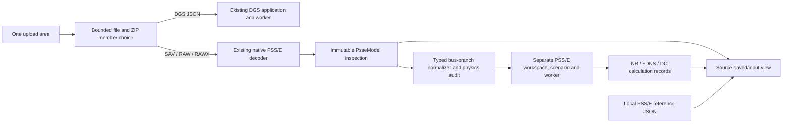

# PSS/E bus-branch analysis architecture

Status: **Gate E conditionally accepts verified fixed profiles; release closure is pending and the overall master scope remains incomplete (section 16).**

Review date: 2026-10-27. Starting revision: `6ed2aaf527ea245948ffe7344bc6d7c73b63b389`, branch `feature/psse-ac-dc-busbranch-v1`. The architect owns this document; implementation belongs to the implementer. This review does not certify numerical parity or final acceptance.

## 1. Boundary and compatibility decisions

The existing `PsseModel` is an immutable, inspection-only source contract. Preserve its schema, decoder, original arrays, field provenance, source operating values, and fail-closed findings. Its `analyses.* = BLOCKED` describes that source inspection contract; do not turn those properties into solver authorization. Add a separate **`PsseBusBranchNetwork`** with independent readiness for NR, FDNS and DC.

Do not convert PSS/E into `CanonicalNetwork`. DGS topology preparation, scenario overlays, station controls, result stores and numerical solvers carry PowerFactory/DGS assumptions that do not establish PSS/E physics. Leave their behavior unchanged. Reuse only verified, source-independent utilities through a narrow adapter: hashing, bounded ZIP extraction, DOM helpers, sparse matrix storage and the embedded KLU linear algebra implementation. Do not reuse the DGS power-flow preparation, Ybus, Newton/control wrappers, results identity or scenario store.



The main app has an explicit mode discriminator (`NONE | DGS | PSSE`), preferably an `activeModel` discriminated union. In PSSE mode the legacy `ctx.network` stays null. Instantiate/render dedicated PSS/E model, analysis, map and SLD features; do not pass a PSS/E context into the existing DGS features. The common header displays the active mode and model name. Switching model or mode cancels in-flight work and invalidates old selections; each mode keeps its own stores and identities. An answer arriving from an older load/run must never be published.

Both the main application and standalone entry point instantiate the **same** PSS/E controller, workspace factories, normalizer and worker. Standalone must not contain a second solver, reduced equations or a reference-results replay path.

## 2. Proposed file ownership and implementation order

Names may be adjusted consistently; the boundaries are mandatory.

| Area | Files / responsibility |
| --- | --- |
| Source decoder, preserve | `src/importers/psse/{decode,types,raw*,sav*,common}.ts` |
| Electrical contract | `src/domain/psse/{network,scenario,results,identity,capability}.ts` |
| Typed mapping | `src/importers/psse/bus-branch.ts`, with small RAW/SAV adapters if needed |
| Numerical preparation | `src/analysis/psse/{prepare,islands,ybus,sparse}.ts` |
| Algorithms | `src/analysis/psse/{mismatch,jacobian,newton,fdns,dc,controls,results}.ts` |
| Worker | `src/workers/psse-analysis.{protocol,transport}.ts`, `psse-analysis.worker.ts` |
| Shared PSS/E controller | `src/features/psse/psse-workspace.ts` or `psse-controller.ts` |
| Dedicated UI | `src/features/psse/{analysis-view,map-view,sld-view,result-source}.ts`; retain existing source inventory views |
| Main routing | Small discriminated routing changes to `src/app/{contracts,controller,app-shell}.ts` and the existing single upload surface |
| File selection | Shared `src/importers/model-file.ts` plus a unified member-selection UI; retain bounded directory read, CRC, size and safe-path checks |
| Standalone | `src/standalone/psse-web.ts` mounts the shared workspace; `tools/{build,package,verify}-psse-web.mjs` includes its exact dependency closure |
| Reference, separate owner | `tools/psse-reference.py`, `PSSE_SOLVER_RESEARCH.md`, private reference evidence |
| Tests/evidence | Focused synthetic equation fixtures; importer regression; local PSS/E parity; mode isolation and offline browser evidence |

Implement in this order: (1) typed normalization/capability audit; (2) sparse primitive stamps/islands and result identity; (3) NR and equation tests; (4) separate FDNS and DC; (5) worker/controller; (6) dedicated views and unified upload; (7) parity fixes and final packaging. Establish the first numerical parity checkpoint before extensive UI work. Do not spend a review gate on every file: architect returns at first parity and final acceptance, or immediately for a critical math ambiguity.

## 3. Typed network and source mapping

`PsseBusBranchNetwork` has its own schema/revision, source SHA-256, normalization revision/hash, system MVA base, stable bus index, buses, branches, generators, ZIP loads, fixed/selected shunts, explicit control descriptions, source-to-numerical mappings and findings. All engineering units and signs are named. Branches retain their primitive four complex admittance coefficients as well as their physical parameters, endpoints, source equipment ID, winding ID, rating basis and origin evidence.

Use source **connection keys**, not external bus numbers, for connectivity. SAV may contain `1000 * externalBus + section`; keep `connectionKey`, external number and section distinct. IDs are deterministic and preserve circuit IDs, orientation and three-winding identities. Source reversed orientation is not permission to reverse a phase shift or the magnetizing side.

Each mapped parameter records the source equipment/field (and SAV array/index/physical offset where available), unit, conversion equation and normalization revision. A derived electrical value remains derived from source; it is not a calculated operating result. Keep the source graph and numerical graph distinct: an internal star bus or contracted ideal connection is mapped back to original terminals.

Do not interpret `null`, missing values, unknown packed status or unknown codes as zero, one, in service, local regulation or a unity tap. Exact defaults explicitly defined by the source format are allowed and recorded. The RAW helper already converts CZ MVA bases and CW winding units; do not apply that scaling twice. Typed normalization must distinguish original RAW nominal impedances from SAV internal admittances, despite similar field names.

`PsseScenario` is a typed immutable overlay keyed to the normalized model. Initially support only operations that the network contract can express exactly: known equipment status, generator P setpoint, load scaling, and explicitly supported fixed tap/phase or shunt selection. Validate ranges and finite numbers before accepting a command. Hash a canonical sorted serialization. Any scenario edit invalidates calculated results and marks any original PSS/E reference as a different case until an equivalent reference is supplied.

## 4. Per-algorithm fail-closed capability audit

Every run performs the audit on the **effective scenario network**, before factorization. Report equipment IDs, exact missing semantics and a remedy. An unsupported energized device blocks affected energized islands; do not silently drop it, use its saved output as a model or return a successful whole-case result. Inventory remains available. Partial per-island results, if exposed, must retain whole-case `BLOCKED/PARTIAL` status and an explicit unsolved-island list.

| Condition | Required behavior |
| --- | --- |
| Missing/unknown active status, bus type, connection, tap, admittance or injection | Block affected method/island; never synthesize physics |
| Active DC converter, FACTS, induction machine, generic network model, voltage-droop/wind controller | Block until its relevant equations/status are implemented and independently verified; saved P/Q is not an admissible replacement |
| Opaque SAV segment/tail with unproved electrical irrelevance | Block; an inspection `PARTIAL` finding cannot be ignored merely because most records map |
| SAV packed switched-shunt status/activation | Decode and verify relevant bits, or block; `status === null` cannot become on/off by guess |
| Fixed-control study | May hold known taps, phase shifts and known selected shunt susceptances, with an explicit `FIXED_CONTROLS` policy and matching PSS/E options |
| Active LTC, phase-shifter, switched-shunt, area interchange or remote voltage regulation requested | Implement its equations/discrete outer loop, bounds and stopping rule, or block that policy; never label a fixed-control run as automatic-control parity |
| Remote generator regulation | Support an explicit regulated-bus voltage equation and validated Q sharing, or block; freezing transformer controls does not disable generator remote regulation |
| Generator Q bounds/local multi-machine sharing | Aggregate validated bus limits, preserve individual limits, use a deterministic supported allocation; record active set; unknown participation blocks per-machine parity |
| No reference or multiple unsupported swing sources in an energized island | Block; no arbitrary bus promotion, synthetic slack or dropped island |
| Zero-impedance switch/connection | Contract only if known ideal and electrically compatible, retaining terminal mapping; otherwise block. Do not substitute an epsilon reactance |
| Unknown terminal/node-breaker relationship | Block topology-dependent calculations until validated bus-branch conversion; inspection may continue |
| Correction table, asymmetrical phase-shifter or connection-angle semantics | Apply validated correction/asymmetry or block; a nonzero table ID cannot be ignored |
| Invalid CZ=3 / CM=2 square root, nonpositive tap/base, nonfinite values | Block with field-level finding |
| DC method | Its stated lossless approximation may omit reactive/charging terms; still block unknown active-P/topology/control semantics |

Keep `structuralReadiness`, `physicsCoverage`, `runStatus` and `referenceComparisonStatus` separate. A converged numerical iteration does not establish full source coverage or reference agreement. Short circuit and N-1 remain explicitly unavailable in this PSS/E feature unless separately implemented.

## 5. Units, signs, branches and transformers

All internal powers/admittances use per unit on `Sbase` MVA; bus voltage magnitudes are per unit on their own source kV bases; angles are radians internally and degrees at import/export/UI boundaries. Bus injection is positive **into the network**. Branch `Sfrom` and `Sto` are injections into the branch from their corresponding buses, so branch loss is `Sfrom + Sto`.

For a line, `y = 1/(r + jx)`, terminal shunts are `yf = gi + j(bi + btotal/2)` and `yt = gj + j(bj + btotal/2)`. Its stamp is `Yff=y+yf`, `Yft=-y`, `Ytf=-y`, `Ytt=y+yt`. Do not discard conductance or end-specific shunts. Fixed bus shunt is `(GL + j BL)/Sbase`; positive `BL` injects reactive power, so its consumed complex power is `|V|^2 * conj(Yshunt)`. Stamp it exactly once.

### Winding, impedance and magnetizing conversion

For winding `w`, let `Vbw` be bus base kV and `Vnw = NOMVw > 0 ? NOMVw : Vbw`. The bus-base off-nominal magnitude is:

- CW=1: `tw = WINDVw`.
- CW=2: `tw = WINDVw / Vbw`.
- CW=3: `tw = WINDVw * Vnw / Vbw`.

For a measured pair on MVA rating `Sr`, convert the **nominal-winding** impedance to system MVA base:

- CZ=1: `z0 = R + jX`.
- CZ=2: `z0 = (R + jX) * Sbase / Sr`.
- CZ=3: `rr = lossWatts / (1e6 * Sr)`, `xr = sqrt(Zmag^2 - rr^2)`, then `z0 = (rr + j*xr) * Sbase / Sr`.

The winding voltage-base conversion is carried by the winding taps below. Do not add another nominal/bus voltage multiplier on top of this two-sided form.

For an ordinary two-winding transformer, `a1 = t1 * exp(j*ANG1)`, `a2 = t2` (ANG1 converted to radians), `y0=1/z0`. The exact series primitive is:

```
Yff = y0 / |a1|^2 + Ym_bus1
Yft = -y0 / (conj(a1) * a2)
Ytf = -y0 / (conj(a2) * a1)
Ytt = y0 / |a2|^2
```

Equivalently, use single from-side tap `a=a1/a2` and **effective** impedance `zeq=|a2|^2*z0`, then `Yff=(1/zeq)/|a|^2+Ym_bus1`, `Yft=-(1/zeq)/conj(a)`, `Ytf=-(1/zeq)/a`, `Ytt=1/zeq`. This secondary-tap impedance factor is required; dividing taps without changing impedance gives a wrong circuit when `t2 != 1`.

Magnetizing admittance is directly at winding-1 bus, **outside** the ideal tap. For CM=1, `Ym_bus1 = MAG1 + j*MAG2`. For CM=2, `gRated=MAG1/(1e6*Sr)`, `bRated=-sqrt(MAG2^2-gRated^2)`, and `Ym_bus1=(gRated+j*bRated)*(Sr/Sbase)*(Vb1/Vn1)^2`. Validate the radicand and source current/loss units. Do not scale this shunt by the tap a second time. This follows the installed Siemens DataFormats transformer definitions and PAGV1 circuit, printed pp77–79.

### Three-winding conversion

Convert all three pair impedances to the same nominal-winding/system-MVA convention first. Introduce exactly one internal zero-injection star bus per source transformer:

```
z1 = (z12 + z31 - z23)/2
z2 = (z12 + z23 - z31)/2
z3 = (z23 + z31 - z12)/2
```

Connect terminal `w` to the star using tap `aw=tw*exp(j*ANGw)` and star-side unity tap; apply winding-1 magnetization at its external bus. A negative star leg can be a legitimate equivalent of valid pair measurements; do not reject it merely for its sign or clip it. A singular leg requires an exact constrained treatment or a clear gate. Source status 2 opens winding 2; 3 opens winding 3; 4 opens winding 1; 0 opens all. Preserve each winding's flow, status and rating. SAV may already contain the internal star: reuse/map it or rebuild it once; never retain two star networks.

### SAV-specific critical gate

`Gbtran` is a saved internal admittance; `Windrp`, `Windrs`, `Psangl`, `Tapno` orientation and both `Gbline` ends must be interpreted as one coherent primitive. The inspection fields currently expose system impedances and nominal-looking RAW aliases; their names do not prove whether secondary-tap scaling is already incorporated. Validate at least a nonunity secondary tap, nonunity primary tap, nonzero phase shift and nonzero magnetizing fixture against PSS/E before authorizing the corresponding SAV physics. Use original `binaryArrays` and field-level evidence when the inspection summary collapses end-specific data. If the decoder's source representation lacks a needed distinction, add a typed downstream adapter/derived record rather than mutating source saved values. No double scaling, summing two terminal shunts onto one end, or reversal of a phase-shifter side is acceptable.

## 6. ZIP load equations and full Newton method

For each active load at magnitude `v`, with original RAW/RAWX MW/Mvar coefficients defined at 1 pu, the reactive admittance coefficient **YQ is admittance-signed**, unlike IQ: negative YQ means inductive consumption. Normalize the canonical quadratic reactive-consumption coefficient to `qZConsumption = -YQ` exactly once. The source fields and original saved/input values remain unchanged. The SAV `Cfdlfr` third component must map to this same canonical convention using independently verified binary evidence; matching field names alone do not establish a binary-array sign convention.

```
Pload(v) = PL + IP*v + YP*v^2
Qload(v) = QL + IQ*v - YQ*v^2
dPload/dv = IP + 2*YP*v
dQload/dv = IQ - 2*YQ*v
```

Equivalently, canonical consumption form is `Qload=QL+IQ*v+qZConsumption*v^2`, `dQload/dv=IQ+2*qZConsumption*v`. Divide by `Sbase` before numerical use. Represent the entire ZIP expression in specified powers and include its derivatives, **or** move only its impedance part into Ybus as `(YP + jYQ)/Sbase`, equivalently `(YP - j*qZConsumption)/Sbase`, and remove that part from both specified powers and their derivatives. This design chooses the first form to simplify provenance. Do not stamp a load impedance and subtract it as load again. Distributed generation embedded in a load is a separate supported injection with explicit mode semantics; unknown nonzero DG mode blocks.

For each bus, `I=Ybus*V`, `Scalc=V*conj(I)`; specified injection is active generation minus the voltage-dependent load. Define `f(x)=[Pcalc-Pspec at non-reference buses; Qcalc-Qspec at PQ buses]` and solve `J*dx=-f`. Unknowns are angles at PV/PQ buses and magnitudes at PQ buses; reference angle/magnitude and PV voltage setpoints are held. One independently validated reference is required per energized island.

The full sparse polar Jacobian is recomputed for every NR step. With `dij=theta_i-theta_j`, `Yij=Gij+jBij`, and `i != j`:

```
dPi/dtheta_j = vi*vj*(Gij*sin(dij)-Bij*cos(dij))
dQi/dtheta_j = -vi*vj*(Gij*cos(dij)+Bij*sin(dij))
dPi/dv_j = vi*(Gij*cos(dij)+Bij*sin(dij))
dQi/dv_j = vi*(Gij*sin(dij)-Bij*cos(dij))
dPi/dtheta_i = -Qi - Bii*vi^2
dQi/dtheta_i = Pi - Gii*vi^2
dPi/dv_i = Pi/vi + Gii*vi
dQi/dv_i = Qi/vi - Bii*vi
```

The diagonal magnitude derivatives additionally include `+dPload/dv/Sbase` and `+dQload/dv/Sbase` for the chosen `f=calculated-specified` residual. Use electrical calculated P/Q (including Ybus shunts) in the diagonal formulas. Central finite differences on small non-flat ZIP/phase-shift cases must verify the assembled reduced Jacobian independently.

Use sparse CSR/CSC and typed arrays. Build the graph pattern once per island/active set, then update values. Factorize the actual Jacobian with sparse KLU or an equivalently verified sparse backend; check true linear residual. Do not build a dense `n*n` JavaScript array or silently regularize an electrically singular model into success. Existing vendored KLU and embedded WASM may be imported through the PSS/E sparse adapter without changing DGS behavior. Capture dimension, nnz, factor/solve time, backend and failure stage.

Use a bounded line search/damping policy on the true nonlinear residual and a stated positive voltage domain. Failure to find a valid decrease is `NON_CONVERGED`, not a fabricated flat-voltage result. Check cancellation and finite values between iterations/control rounds. A flat start and a source-voltage start are separate explicit options; never use saved P/Q/flows to satisfy residuals. Validate at least one deliberately perturbed/flat-start case so saved converged voltages cannot conceal an ineffective iteration.

For generator Q limits, recover required bus generation from `Scalc + Sload`, compare against aggregate supported generator bounds, clamp and change PV to PQ through a deterministic active set. Rebuild the reduced Jacobian when the set changes. Record limits, conversions and outer rounds. Reference-bus Q exhaustion and ambiguous multi-generator sharing must have an explicit supported policy or a gate. Respect requested PSS/E limit policy, including comparisons with limit enforcement disabled; do not compare two different control problems.

## 7. FDNS is a separate fixed-slope decoupled algorithm

FDNS shares the exact Ybus, loads, injections, island audit and output calculation with NR, but has its own implementation, iteration counters, convergence status and engine method ID. Do not call NR and relabel its result. PSS/E's FDNS is fixed-slope decoupled Newton; the browser implementation must state its selected approximation (initially `FDNS_XB`) and establish numerical solution parity under identical control policies. Identical internal iteration counts are not an acceptance claim.

Initial XB matrix recipe is explicit: `Bprime=-imag(Yangle)` with bus/terminal charging shunts removed, tap magnitudes set to 1, branch R set to 0, and supported phase shifts retained; `Bdoubleprime=-imag(Yvoltage)` with phase shifts set to 0 and actual tap magnitudes, R, and electrical shunts retained. Normalize two-sided transformer circuits to the equivalent single-tap branch before applying this recipe. Exclude ZIP powers from these fixed matrices under the chosen all-ZIP-in-Sspec representation.

At each sweep, calculate the **full AC** mismatch including ZIP at current magnitudes, solve `Bprime*dtheta=(Pspec-Pcalc)/v` on non-reference buses, update angles, recalculate mismatch, solve `Bdoubleprime*dv=(Qspec-Qcalc)/v` on PQ buses, then update magnitudes. Factor fixed matrices once per topology/tap/control active set. Rebuild when the Q active set or electrical controls change. Assess convergence with the original full AC power residual, not only divided mismatch or update size. Singular B matrices, stagnation and iteration limits produce explicit failures. An optional NR fallback, if later added, must publish a distinct hybrid method identity and must not satisfy the FDNS acceptance gate.

This initial matrix recipe is an engineering choice based on the published XB construction; if installed Siemens reference evidence requires a different fixed-slope recipe, version that method and update tests. The fixed point must still solve the exact supported AC equations.

## 8. DC is a real sparse linear solve

Use an explicit `LOSSLESS_DC` approximation with `|V|=1`, neglected R/charging/reactive flows, and known taps/phase shifts. For equivalent single-tap branch `a=tau*exp(j*phi)` and series `xeq`, define `b=1/(xeq*tau)` and oriented incidence row `A_l=[+1 at from,-1 at to]`:

```
pfrom_l = b_l * (theta_from-theta_to-phi_l)
Bbus = A' * diag(b) * A
Pshift = A' * (-b .* phi)
Bred * theta_nonref = Pspec_nonref - Pshift_nonref - B_nonref,ref*theta_ref
```

All quantities above are per unit/radians. Real bus shunt consumption at the chosen 1 pu DC voltage is included in net Pspec if the selected documented reference policy includes it; record that option. ZIP active load becomes `PL+IP+YP` at 1 pu. Unknown active-P contributions still block. Recover reference active generation from island balance. Terminal MW is `Sbase*pfrom`; `pto=-pfrom`, active losses are zero by method assumption. Do not fabricate Q, voltage regulation or AC current/loading results; store them as unavailable. DC voltage magnitude displayed as 1 pu is labelled an assumption. Phase-shift injection sign and nonzero reference-angle RHS require direct synthetic tests.

Never reuse an AC solution's angles or stored branch MW as the DC output. A deliberately changed load must alter the solved DC angles and flows. PSS/E `dclf_2` options and any voltage/loss adjustments belong in the reference metadata; compare the browser lossless policy with the equivalent lossless reference settings.

## 9. Results, provenance and stale-response contracts

Keep three disjoint source categories visible throughout tables, map, SLD and export:

- `SOURCE_SAVED / SOURCE_INPUT / DERIVED_FROM_SOURCE`: original inspection operating/parameter values, with their original field evidence.
- `CALCULATED`: immutable browser calculation snapshot, with algorithm, convergence and full identity.
- `PSSE_REFERENCE`: immutable external local reference snapshot, with PSS/E version, method, options, convergence state and source SHA.

No category overwrites another. A source selector changes presentation only. Difference views require matching topology/scenario, method scope, control policy, units and orientation. If no source exists for a metric, display unavailable rather than borrowing a value from another category. Saved source voltage or branch output can be compared separately, but is not automatically a fresh solved PSS/E reference.

`PsseCalculationIdentity` includes schema/mode, original source SHA-256, normalized model hash/revision, effective scenario hash, exact algorithm ID/revision, control-policy ID/revision, all numerical/control option hashes, and result schema revision. Initial-voltage policy is included. Result IDs derive from that full identity. The worker request/response additionally carries run/load generation and request ID. Publish only if every current identity field matches; a late result, mode switch or cancellation must not reanimate stale data. Cache PSS/E under a distinct persistence namespace; never write its results into the DGS `ResultStore` or legacy workspace cache.

A result records `CONVERGED | NON_CONVERGED | BLOCKED | CANCELLED | ERROR`, coverage, per-island references and outcomes, max actual P/Q mismatch, final voltages, terminal powers, losses, generator allocation, control states, iteration/outer-round history, elapsed timings, sparse diagnostics, findings and options. `CONVERGED` requires all supported energized islands solved and full residual/finite checks passed. Nonconverged iterates may be inspectable with explicit diagnostic styling but cannot drive a normal successful-results layer.

Generator outputs are recovered from solved injections, not copied indiscriminately from source setpoints. At a reference bus, total active generation is `Sbase*(Pcalc+Pload)`; for a single active generator this is its calculated P. Nonreference generator P stays specified under the supported fixed-dispatch policy. Likewise, calculated generator Q totals must equal `Sbase*(Qcalc+Qload)`. When reactive limits are disabled, output allocation must not clip Q or mark an enforced limit. When limits are enabled, the electrical active set and output allocation must agree. Individual-machine allocation must conserve the solved bus totals with finite values; any unverified multi-machine sharing rule is disclosed and cannot pass per-machine PSS/E parity. Plant RMPCT alone does not establish within-plant individual-machine P or Q sharing. Zero-weight units receive zero participation when any positive weights exist; equal fallback is applied to the whole all-zero group, not independently in each numerator.

## 10. Views, upload and standalone packaging

The shared upload area accepts DGS JSON, SAV, RAW, RAWX and ZIP. Inspect a ZIP once with the union of permitted extensions. If more than one supported member exists, show each member's full name, format and size and require the existing explicit member choice; do not choose DGS or PSS/E by archive filename or silently open the first member. JSON is classified by validated schema/content after selection; reference/study JSON is not automatically a DGS model. Standalone can restrict to PSS/E model formats while sharing this exact selection mechanism.

PSS/E model pages reuse the source inventory and add normalized electrical model/readiness views. Analysis offers NR, FDNS and DC separately, settings/control policy, run/cancel, convergence diagnostics and result-source choice. Map uses only source-supported coordinates, with missing-coordinate counts; no invented geographic locations. PSS/E SLD is a dedicated bus-branch schematic with deterministic fallback layout, electrical terminals, three-winding identity and equipment selection. Its non-geographic layout is labelled accordingly. Both views use the same selected immutable result snapshot; active method/source and stale/unavailable states remain visible. Normalized star buses may be hidden by presentation while their mapping stays inspectable.

Standalone output stays self-contained on `file://`: classic IIFE, inline CSS, inline Blob workers, embedded KLU WASM/data and no runtime fetch/import/CDN. The current CSP `script-src 'unsafe-inline' blob:` may need the narrow `wasm-unsafe-eval` addition for WASM compilation; test the actual offline extracted artifact in Chrome/Edge. `connect-src 'none'` stays. Include required third-party license texts for the actual runtime closure. Packaging must enumerate all newly required domain/analysis/worker files rather than only the old importer paths. Record source revision, normalized/engine revisions and SHA-256 of HTML/ZIP; package and main app parity must come from identical modules.

No licensed model input, Siemens DLL/PYD/EXE, local Python runtime, source model dump or proprietary documentation is committed or packaged. Keep detailed private reference exports and identifying model screenshots under ignored local paths, subject to the user's delivery scope. Public evidence is sanitized counts, hashes, statuses, tolerances and reproducible synthetic fixtures. Existing distribution checks must cover all newly included entries and both archive contents and extracted runtime behavior.

## 11. Verification and acceptance gates

### Implementer checks before first parity

1. Preserve native importer tests and the DGS baseline. Add meaningful synthetic tests for nonunity secondary tap, opposite phase orientation, terminal shunts, CW/CZ/CM variants, 3W star/status, ZIP finite-difference Jacobian, island reference handling, unsupported-active-device rejection, Q active-set behavior, and DC phase shift.
2. Show real NR iterations from flat/perturbed voltage; full AC residual decreases to the stated tolerance. Show FDNS uses independent fixed matrices/updates and converges on a suitable case; show DC uses an independent linear system.
3. Demonstrate sparse size/nnz scaling and no dense numerical matrix construction on the real model. Linear residual, total mismatch and branch/bus balance must be independently recomputed from final output.

### First numerical parity review

The local harness must reset/reload the source before **each** method/options combination and save method name, options, source SHA, PSS/E version, `ierr`, solved status, maximum mismatch, terminal orientation and returned finite-value counts. Error-free API calls alone do not prove convergence. Test source SAV, its independently exported RAW and suitable installed example cases, without putting model bytes into Git.

Compare matched bus voltage magnitudes and island-reference-adjusted angles, generator totals/limit states, both branch terminals and losses. Match branches by original endpoint/circuit/winding identity, never sorted endpoint alone. Separate source-import precision deltas, unsupported physics, reference failure and browser numerical failure. Provisional strict targets for equivalent converged AC cases are maximum `|delta Vm| <= 1e-5 pu`, angle `<= 1e-3 deg`, and terminal P/Q `<= max(0.01 engineering units, 1e-5*|reference|)`; document actual import precision, reference stopping tolerance and any justified gate-specific bounds before calling a comparison PASS. Internal mismatch target is explicit and at least as tight as the comparison requires (initial target `1e-6 pu`). DC compares only quantities its model calculates. A reference method that fails to converge is recorded as such and cannot be converted into a parity pass.

### Final acceptance review

Run appropriate type/lint/unit/build checks, the existing DGS regression boundary, main-app SAV/RAW/ZIP routing, ambiguous mixed ZIP choice, mode switching/cancel/stale-response isolation, three separate solver actions, source/result/reference selection, dedicated map/SLD states and exports. Then build/package once, extract to a fresh directory, open `file://` with network disabled and run the same synthetic/real supported calculation identities. Require zero runtime HTTP(S) requests, no missing worker/WASM/license assets, no browser errors, correct artifact hashes, no private/vendor files and no reuse of source saved values as calculated results. A physics blocker remains visible and documented; it is not an acceptance success for the blocked target case.

## 12. Principal risks and unresolved evidence

- SAV packed controls, unknown electrical tails and active DC/FACTS can legitimately prevent solving the target case until decoded and implemented. Do not trade coverage for a green convergence label.
- SAV transformer internal admittance conventions and collapsed magnetic-side data require the explicit first-parity evidence above. RAW and SAV aliases must not share an unproved conversion path.
- Local/remote generator regulation and Q allocation are part of the equations even in a fixed tap/shunt study. They may dominate parity before NR numerical quality does.
- PSS/E FDNS uses its own fixed-slope construction/control scheduling. Root-equation parity is the first acceptance target; method naming and diagnostics must describe the browser algorithm honestly.
- Existing main-shell features are eagerly created and use DGS stores; route/instantiate PSS/E features without causing DGS results, scenario persistence or map/SLD assumptions to execute on PSS/E data.
- WASM CSP behavior and newly expanded dependency/license packaging must be verified on the final `file://` artifact, not inferred from Vite development behavior.

## 13. Gate C — first actual numerical parity (2026-10-27)

Evidence reviewed: `evidence/psse-ac-dc/parity-nr_polar.json`, `.tmp/first-nr-parity.log`, and only the affected new production normalizer, capability, NR/FDNS, residual, Jacobian and result-output modules. All eight original synthetic RAWX cases use browser flat-start NR and independent PSS/E FNSL references with `ierr=0`, `solved=0`. Browser cases converge in 3–4 iterations, with final reported P/Q residuals no greater than `2.22e-9 pu`.

**Decision: numerical core direction approved; complete parity remains DIFFERENCES pending targeted fixes.** The seven non-ZIP cases have max voltage difference `8.36e-8 pu`, max angle difference `1.02e-6 deg`, and max terminal P/Q difference `1.44e-4 MW/Mvar`. This is strong evidence for the tested ordinary line, two-sided tap, phase shift, three-winding, CM=2 and shunt equations. It does not authorize untested SAV packed/internal conventions, controls, FDNS, DC or the large private model.

Required corrections before a parity PASS:

1. **Architecture erratum, now corrected above:** Gate A incorrectly treated source YQ as reactive consumption. Installed Siemens DataFormats load definition, printed p14, specifies its inductive/capacitive admittance sign. For original source YQ, use `Qload=QL+IQ*v-YQ*v^2` and `dQload/dv=IQ-2*YQ*v`, or normalize `qZConsumption=-YQ` once and use the canonical plus form. This caused the ZIP fixture's `0.0151596 pu` voltage and approximately `15.73 Mvar` terminal Q differences despite a small residual for the wrong equations. Preserve inspection source values; verify equivalent SAV fixtures independently.
2. **Slack active output:** Current generator results copy specified/saved P even at the reference bus, producing `0.848–2.032 MW` differences while branch flows match. Recover the solved reference-bus generation and allocate it conservatively to active units; do not alter the specified nonreference dispatch.
3. **Reactive allocation versus policy:** Current final allocation clips individual Q despite `reactiveLimitsEnabled=false`, causing a `51.2099 Mvar` output error in the limit fixture while voltages and flows match. No clipping is allowed under that policy. A shared NR/FDNS output/allocation routine must preserve required bus Q, respect the requested limit policy, and avoid zero-participation numerator fallbacks that change the sum. In constrained runs, allocation must agree with the solved PV/PQ active set. Per-machine PSS/E sharing requires documented evidence rather than an assumed RMPCT rule.
4. **FDNS fixed-matrix recipe:** For the documented XB construction, first use equivalent `zeq=|tapTo|^2*zNominal`, `tau=tapFrom/tapTo`; cancelling tap magnitude in Bprime does not cancel the effective-impedance factor. Setting both original winding taps to unity while retaining nominal X defines a different approximation. Use the documented effective-X recipe or explicitly version/document a justified alternative; both must converge against the original full AC residual.

Re-run targeted sign/Jacobian, slack balance and Q-policy fixtures, then independent NR/FDNS/DC parity. Include both inductive and capacitive nonzero YQ at nonunity voltage, central finite-difference reactive-load derivative, single-unit slack P matching branch+shunt losses, unconstrained Q exceeding source bounds, constrained PV-to-PQ, and multi-unit allocation sum/zero-weight cases. Use generated original SAV fixtures for the binary transformer/sign checks. Keep failed first-parity evidence as diagnostic history.

The real private target's active voltage-droop controls and remote regulation remain physics blockers until supported; a low numerical residual from a simplified model cannot pass its source-complete gate. Known finite nonzero system-switch reactance is distinct from an ideal switch: a verified exact branch interpretation can be supported, whereas an unknown/zero-reactance topology requires validated contraction or a blocker.

## 14. Critical control clarification — equal reactive limits (2026-10-27)

The bench SAV comparison exposed a source-control classification error: a Type-2 bus is not necessarily an operative PV bus when its connected conventional machines have no reactive control range. This is independent of a saved negative Jcode. The controlled saved-active-set experiment in `evidence/psse-ac-dc/q-active-state-reference.json` shows that reloading an ordinary Q-limited SAV then solving with limits ignored restores voltage regulation; therefore no blanket rule freezing saved negative Jcode is admissible.

Installed Siemens DataFormats Generator Data defines equal QT/QB as fixed-output/nonregulating and identifies voltage-controlling plants by unequal reactive limits. The installed POM SOLV option describes ignored limits specifically for Type-2 buses with unequal var limits. Ignoring reactive limit monitoring does not create voltage-control capability for intrinsically fixed-Q machines.

`tools/psse-fixed-q-diagnostic.py` independently varies only original public three-bus machine records. Results in `evidence/psse-ac-dc/fixed-q-plant-reference.json` use PSS/E 36.5 FNSL `[0,0,0,0,0,1,-1,1]`; all four runs have `ierr=0`, `solved=0`, zero export errors:

| Type-2 plant configuration (WMOD=0) | Calculated machine Q, Mvar | Calculated plant Vm, pu | Scheduled VS, pu |
| --- | --- | --- | --- |
| One unit, QT=QB=5, input QG=0 | 5 | 1.0274786 | 1.06 |
| One unit, QT=QB=5, input QG=9 | 5 | 1.0274786 | 1.06 |
| Fixed unit QT=QB=5 plus regulating unit QT=100/QB=-100 | 5 and 51.20134 | 1.06 | 1.06 |
| Two fixed units QT=QB=5 and QT=QB=-3 | 5 and -3 | 1.0255069 | 1.06 |

The supported conventional Type-2 rule is therefore:

- A fixed-Q unit has **exact validated QT=QB** and its fixed output is that common value, not input/saved QG. Record this intrinsic control kind separately from an enforced Q-limit active state. Do not substitute a tolerance that treats a narrow but unequal range as equal.
- A plant with no active variable-Q units is operative PQ, with specified Q equal to the sum of fixed unit Q minus voltage-dependent load. Its voltage is an unknown; VS remains a source schedule but is not an imposed equation. This applies even when `reactiveLimitsEnabled=false`.
- A mixed plant remains operative PV while at least one supported regulating unit remains. Fixed units contribute their known Q. The regulating aggregate is solved bus Q generation minus the sum of fixed unit Q. With exactly one regulating unit its output is determined; with several, individual sharing remains unavailable unless independently verified. Fixed-unit outputs remain available even when variable-unit sharing is unavailable.
- With reactive monitoring enabled, aggregate plant bounds include fixed Q plus the regulating-unit bounds. Fixed units do not receive part of a regulating allocation. The same control classification, residual, initialization and output rules apply in NR and FDNS.

This discriminator establishes the conventional WMOD=0, source-Type-2 profile only. Reference/slack angle and voltage treatment, source Type-1 machines, other WMOD values, droop and remote regulation retain their separate supported-policy requirements. Re-run the bench comparison after the targeted correction; the previous `0.01888 pu` Vm / `69.9 Mvar` Q difference is diagnostic evidence, not a parity pass. No cached large experiment was rerun during this control review.

## 15. Critical topology clarification — zero-impedance lines and DC recovery (2026-10-27)

Installed Siemens DataFormats §1.13.1 explicitly contracts an active **nontransformer** branch when `R=0` and `|X| <= THRSHZ`; an enabled bypass flag independently selects zero-impedance treatment. During the electrical solution its endpoint voltages are identical. THRSHZ=0 disables the threshold rule. A zero-impedance line may retain terminal charging/shunts; these remain attached to their original buses and are aggregated once during contraction. System switching-device X defaults to THRSHZ. Source switch status and bypass semantics remain explicit; do not classify every small-X transformer as an ideal connection.

**Threshold evidence:** installed `solution_parameters_5` documentation gives REALAR(11) as THRSHZ, default 0.0001. The paired original RAW explicitly supplies GENERAL THRSHZ=0.0001. The independent original three-bus metadata-only experiment `tools/psse-threshold-metadata.py` changes only this option to 0.00037, saves before/after, and performs **zero power-flow solves**. Decoding those files identifies SAV `Headre[12]` (one-based; JSindex11) as THRSHZ; `prmdat('THRSHZ')` agrees. See `evidence/psse-ac-dc/threshold-metadata-reference.json`.

Retain the original source threshold, scalar values and provenance in the normalized model and calculation identity. The real SAV threshold is the Float32 value `0.00009999999747378752`; its derived reciprocal-admittance switch X may appear as JSdouble0.0001. Reproduce the validated source Float32 comparison at this boundary (for example, compare `Math.fround(abs(X))` with `Math.fround(THRSHZ)` for these Float32 source records). An arbitrary epsilon is not a substitute. RAW/RAWX may supply GENERAL explicitly; otherwise record the documented format/API default and the supported scalar interpretation rather than silently guessing a SAV header value.

### Contraction contract

Build deterministic connected components of qualified active ideal links. Validate compatible bus voltage bases, the current profile's unity taps/zero phases, active terminals and reference consistency. Keep all original equipment IDs, orientation, terminal attachments, source X, ratings and source-to-supernode mappings. Aggregate original nodal active injections and real-shunt consumption into each supernode, respecting the selected source-voltage policy. Preserve original branch terminal conductance outside the eliminated series link. Solve the reduced network with the **same production DC engine**; expand each supernode angle identically onto all member buses. Recompute components after a scenario switch operation. Do not represent ideal links by a very large susceptance, perturb their displayed physical angles, or retain their finite series impedance in the external network.

Recovery is separate from the contracted angle solve. Let B be the original-bus by ideal-edge incidence matrix (+1 at from, -1 at to). After calculating all nonideal branch flows, each original bus needs ideal-link outgoing flow

```
d = Pg - Pload - PrealShunts - PnonidealOutgoing
B * f = d
```

Use a consistent MW or per-unit basis. At an island reference, recover required generation from the solved supernode balance; do not use cached/saved slack generation as if it were a solved DC injection. Require each component's sum(d) to meet the stated balance tolerance. Tree-component flows are uniquely determined by KCL. A tree walk or the sparse recovery system below may calculate them; source IDs/orientation must be retained.

### Cyclic recovery: validated positive equal-X profile

The manual states that loop flows are nonunique from ideal topology alone and that PSS/E uses the specified branch reactances to determine them. For positive X, the natural reactance-weighted recovery is

```
W = diag(1/X)
L = B * W * B'
L * lambda = d                 (pin one auxiliary potential per component)
f = W * B' * lambda
```

It is the unique minimizer of `0.5 * sum(Xe * fe^2)` subject to `B*f=d`. Lambda is an **auxiliary recovery potential**, not a physical bus voltage angle; do not add it to displayed electrical angles. Scaling every X in one component by a common positive constant leaves f unchanged and can improve numerical scaling. Verify true sparse residual, original-bus KCL and weighted cycle consistency; do not let arbitrary traversal order choose a circulating flow.

For this real case, all 928 qualified switches have the same positive source X. Their graph has 1772 original vertices in 861 nontrivial components, cycle rank 17 in 7 cyclic components. The retained PSS/E report's complete ideal-edge flow vector, projected onto this weighted cutspace while preserving its reported nodal balances, changes by at most **0.0333334MW**, within the report's0.05MW half-step. This is independent evidence for the equal-positive-X cyclic rule on the actual cycles; tree edges alone could not establish it. The installed statement supports retaining specified weights, but this cache cannot independently distinguish different positive unequal-X weighting formulas because all tested X values are equal. Unequal positive weights need an original discriminator before claiming equivalent PSS/E behavior for that broader profile.

Preserve signed source X. A negative/signed cyclic system is not a convex minimum-energy problem; never substitute abs(X). Zero-X cyclic recovery and singular/canceling signed cycle Laplacians lack a validated unique rule in this profile. Gate their individual flows (and any dependent loading/parity claim) until a supported rule is established. A tree's unique KCL flows do not require a fabricated reactance.

### Evidence and acceptance status

`tools/psse-dc-contraction-experiment.ts` uses the existing normalized source, the actual production `solvePsseDc`, shared sparse KLU, and retained PSS/E cache. It provides no second runtime solver and performs no new large PSS/E solve. Detailed identities/differences remain under ignored `private-re/dc-contraction/`; aggregate results are in `evidence/psse-ac-dc/dc-contraction-experiment.json`.

The independent contracted-engine experiment reduces 6851 total bus records to 5940 (911 eliminated aliases), then expands angles and recovers 928 switch flows. Its original-bus nodal residual is below `7.4e-10MW`. Compared with the cached reference, maximum terminal error falls from 40.57MW to **0.2467MW**, and maximum active-bus angle error from 0.0671deg to **0.006285deg**. Ninety-eight compared from-terminal rows still exceed the current 0.051MW bound. Thus contraction and the tested cyclic policy are supported, while **full real-case DC parity remains DIFFERENCES**; do not widen the bound or count this experiment as a final PASS. Remaining reference precision/equation differences require separate evidence. A cached API-angle reconstruction also exhibits errors beyond report half-step on very small finite-X branches; rounded/native-precision reference angles must not be treated as exact recovery injections.

## 16. Gate E — final targeted architecture audit (2026-10-27)

**Decision: conditional acceptance of the verified fixed-control profiles only. This does not certify the user's complete master scope as finished.** The final checks and small corrective gates below must close before release acceptance. A later record of their actual outcomes may close this gate without repeating the mathematical review or licensed reference experiments.

The targeted audit reused all prior reviews and retained evidence. It examined current capability/publication gates, the three solver completion paths, DC contraction/recovery, source threshold/bypass provenance, worker cancellation and controller identity checks, reference matching, mode routing, and the limited DGS changes. It did not reread the whole repository or rerun a large licensed calculation.

### Evidence accepted and its limits

- The generated parity report contains **87 unique comparisons: 74 PASS, 10 BLOCKED, 1 REFERENCE_NOT_CONVERGED, 2 strict DC DIFFERENCES**. Duplicate retained rows are not counted as independent successes. These outcomes support only their exact source, algorithm, initialization and Q/control-policy identities.
- Bench NR and FDNS pass numerical comparison after the verified fixed-Q plant correction. All 1648 physical bus kV bases are missing, so the selected per-unit equations may be solved while kV-dependent ampere/current-rating outputs remain unavailable. No physical voltage base is invented.
- Strict DC differences remain **0.053319MW** for bench and **0.2466915MW / 0.0062844deg** for the real case. Both are within the original user contract's 0.5MW / 0.05deg bounds, while the stricter development DC 0.051MW gate remains DIFFERENCES. Keep both statements and their distinct tolerances visible; do not relabel strict evidence as PASS or claim unrestricted PSS/E equivalence.
- Large real AC remains BLOCKED for unsupported remote/droop controls and ideal-link AC contraction. Known pure-Q control omission in the explicit fixed-P lossless DC approximation is a method definition; it is not permission to omit an unknown active-P device. Unknown special-device or material control equations remain blockers.
- The team reports the complete DGS/browser e2e suite passed, project typecheck passed, and focused solver/reference checks passed. The latest pre-final-fix offline artifact `ef40857469bdb195c6f9a4263e0197bb32481b7adc6f5b3401a3e92ed4de38f5` passed installed Chrome/Edge small-mode checks with no HTTP(S) requests or browser errors. That hash does **not** certify later source corrections until rebuilt and tested.
- The last full unit snapshot had 835 tests, 834 passing, with only the tracked portable-versus-HEAD provenance check pending the implementation/blob commit. A successful post-commit full run remains required. Final native SAV/RAW, cancellation/reference browser checks and final extracted ZIP verification were pending when this audit began.

### Targeted findings and required closure

1. **Reference angle units:** `ANGLE` is radians; `ANGLED` is degrees. The comparator originally selected ANGLE as a fallback but returned its value as degrees before reaching the conversion. The responsible implementer reports the correction and a nonzero ANGLE-only regression passing, with equivalent ANGLED behavior. Keep this fix in the final rebuilt artifact and test its out-of-tolerance negative case; it does not change any engine equations.
2. **DCLF saved-angle provenance:** installed DCLF_2 STATUS(4)=0 saves original voltages; STATUS(4)=1 saves base-case DC voltages. A comparator consuming API bus angles as DC evidence must require the supported base-case save flag (`options[3]===1`) and unchanged base topology, preferably the exact narrow validated `[0,0,1,1,0,1]` reference profile. Other flag arrays must not be accepted merely because their values are 0/1. This gate and its rejection regression were assigned to the reference owner during the audit.
3. **RAW GENERAL parameters:** the preserved RAW representation is `sourceTables.SYSTEM_WIDE`, with rows such as `{sourceField1:'GENERAL', sourceTokens:['GENERAL','THRSHZ=0.0001','PQBRAK=0.7', ...]}`. RAWX uses `sourceTables.GENERAL[0]` with named lower-case fields. The threshold reader previously missed explicit RAW GENERAL and silently used the default. Parse supported named parameters downstream with case/whitespace handling and exact provenance, or block unsupported explicit values. In particular, source THRSHZ=0 must disable threshold-based contraction rather than becoming default 0.0001.
4. **PQBRAK source law:** the current source-compatible load profile intentionally refuses unsupported constant-power behavior below its validated breakpoint. It cannot silently assume 0.7 when the source configures another value. The narrowly authorized original three-bus metadata-only save (zero power-flow solves) proves SAV **Headre[2] one-based / JSindex1**, Float32: API REALAR(10)/`prmdat('PQBRAK')` and decoded values both change from `0.699999988079071` to `0.8199999928474426`. Other saved diagnostic header entries also change, so only this exact parameter correspondence is claimed. Evidence: `evidence/psse-ac-dc/pqbrak-metadata-reference.json`; helper: `tools/psse-pqbrak-metadata.py`. Compare the SAV default at Float32 precision. Until a broader law is implemented, a finite explicit nondefault PQBRAK must produce an AC capability blocker, not a generic ZIP success.
5. **Publication for partial coverage:** material missing electrical equations must produce BLOCKED. For a mathematically solved but limited output/profile case, retain numerical convergence internally and expose an overall **LIMITED_PROFILE** status, with an explicit statement that only the named equations reached the residual threshold. Do not publicly show an unqualified CONVERGED/READY/equivalent label while coverage is PARTIAL. Missing bench kV/amp outputs, unavailable individual-machine allocation, and the declared DC reactive/voltage approximation must be distinguished from unimplemented material physics. JSON/CSV may retain separate numerical status and coverage/profile fields; their overall presentation must not imply complete source or master-scope validation. The shared controller, analysis and diagram labels were assigned this publication change.
6. **DC low-voltage active-load law:** PAGV1 §7.5.3 explicitly establishes working-voltage real-shunt consumption and optional loss estimation; it does not prove that DCLF evaluates PL/IP polynomially below AC/source load breakpoints. In the source-saved-voltage DC profile, an active nonzero PL below its source PQBRAK, an active nonzero IP below the validated0.5 breakpoint, or unknown/custom active load-type/curve semantics must therefore be BLOCKED until their source active-P law is verified. Purely reactive load coefficients alone do not block an explicitly fixed-P DC approximation. A custom/invalid PQBRAK gate limited to AC is insufficient for this material active-P boundary. The real target's constant-P loads remain eligible only where their used source voltages satisfy the supported profile.

The corrective gates/publication changes were still in progress at the time of this delta; a report of assignment is not a passed check. The parent must record actual focused regressions/typecheck plus a fresh final HTML/ZIP hash and browser outcomes after all source changes are included.

### Isolation and DGS review

PSS/E retains a distinct normalized model, scenario, calculation result and calculation worker. It does not populate DGS `CanonicalNetwork` or its result stores. Mode/model changes cancel the calculation worker; controller job generation, source/network object checks and scenario hash reject late responses. Scenario changes clear the PSS/E calculation. The native source inspection remains distinct from calculated output and PSS/E reference data; the decoder change adds original SAV bypass field/array provenance rather than manufacturing a calculated value.

The comparator checks source SHA, method, normalized model/revision, topology, base scenario, policy/version fields, solver completion and exact directed equipment/winding identity. Duplicate, missing, nonfinite or unavailable required records prevent a complete match. A reference options hash belongs to the other engine and is not incorrectly equated with the browser options hash. A MATCHED result means agreement only within the named comparison profile and its stated tolerance.

The DGS numerical solver/topology equations are unchanged in the reviewed diff. Shared-shell changes route mode-specific model/analysis/map/SLD/help/settings. The small existing SC change constrains its table host to horizontal overflow; it changes layout only. Browser harness changes scope selectors to the visible DGS workspace, wait for the requested loaded model and completed busy/input state, and explicitly navigate to analysis after a load. These changes repair test assumptions about the new common shell; they do not relax physical acceptance checks.

Standalone builds from `src/app/bootstrap.ts`, the same modules as the main app. Its inline IIFE/Blob-worker and embedded WASM paths, no-network CSP and license inclusion are coherent with the architecture. Source/package filters exclude SAV/RAW/RAWX and vendor executables/libraries. Only a freshly extracted, hashed artifact tested after final fixes can establish delivery closure; a successful source build alone cannot do so.

The packaged Turkish README must describe the present fixed-profile capabilities and limitations rather than retain the previous inspection-only/all-analyses-blocked instructions. Include retained original metadata-experiment helpers alongside their aggregate evidence if that evidence is part of the authored-source delivery.

### Explicit unfinished master scope

Distributed slack and its participation/allocation policy, automatic transformer tap/phase control, automatic switched-shunt control, area interchange control, remote/droop AC regulation, and active special-device equations are not accepted as implemented by this audit. AC ideal-link contraction and broader signed/unequal-X cyclic flow semantics also retain their documented limits. Source profiles requiring these facilities must remain blocked or explicitly outside the selected fixed profile. Short circuit and N-1 are not implemented for the new PSS/E calculation path. Verified fixed NR/FDNS/DC, source inspection, UI routing and offline packaging do not constitute completion of those master requirements.

### Release closure required

Close the targeted code findings with meaningful positive/negative regressions and typecheck. Rebuild the final common offline artifact; run native SAV/RAW, mixed ZIP choice, all three supported methods, source/reference separation, LIMITED_PROFILE/blockers, scenario/cancel/stale-result isolation and installed Chrome/Edge `file://` checks. Commit the correct portable artifact provenance and run the full required suite successfully. Package and extract to a fresh directory, verify manifests/dependency/licenses/no forbidden files, and test that extracted HTML with no network/backend. Record the resulting revision, HTML/ZIP SHA-256 and actual outcomes. Until these outcomes exist, Gate E remains **conditional**, and the overall master scope remains **incomplete**.

## 17. V2 gate 1 — electrical scope and experiment plan

The new task applies `GA_PSSE_KOTA_DOSTU_DUZELTME_AGENT_PROMPTU_V2.txt`. Its verified starting branch is `fix/psse-v1-real-model-parity`, based on remote `e3fdc50d23c4ddea47c8e746853db25c19478458`. This is the first of the three prescribed architect gates: scope/experiments now, first numerical root cause next, critical acceptance last. Reuse the existing mathematical reviews, source inventory and method/options caches. No production change is authorized merely by this plan.

**Distinct new source:** `20261026_1600_SN1_TR0.sav`, SHA-256 `8cc8ccfeca14001c392d2bebf578caafe61589c431f071f64db235a81dbbe60b`. Native audit reports 6875 buses, 2414 lines, 3715 transformers, 2932 generators, 2516 loads, 2571 switches, 137 fixed shunts and 1625 substations. Its normalized graph has 8700 branches. Detailed source evidence stays private. No RAW was supplied; the oracle owner will export a RAW and record original-SAV hash, export hash, API/version and inventory correspondence. A sidecar inventory JSON or IEC/GCP/MON/CON record is not an electrical RAW substitute. Source substation coordinates are available, but valid lat/lon alone does not prove every bus-to-substation attachment.

Initial new-model AC/FDNS blockers are ideal-link AC contraction, 161 active unsupported other records, 1263 machine wind/droop controls, 454 remote regulation records and one PV bus without an active generator. DC is blocked only by that last check; known pure-Q omissions are separately reported. Classify blockers by actual device/control semantics, not severity counts alone. Genuinely incomplete large AC is allowed to remain **BLOCKED**; do not suppress its controllers to manufacture convergence.

### Next experiments, in order

1. **DC eligibility discriminator:** author a small original three-bus pair differing only in bus-2 IDE2 versus IDE1, with no active generator at that bus. Repeat with its machine present but out of service. Reload each source and run DCLF_2 `[0,0,1,1,0,1]`, recording source bus types before/after, exact options, API completion, angles, both directed MW and balance. Nonreference DC equations have no Vm setpoint; a known zero-generation node is mathematically admissible. Only after oracle agreement, make `PV_WITHOUT_ACTIVE_GENERATOR` an AC-only check. Negative fixtures must retain missing-reference generator/island blockers. Preserve all active-P, source-law, bypass, threshold and topology gates. NR/FDNS eligibility must not broaden through this DC correction.
2. **New source baseline:** run/cache one reset-source fixed-profile FNSL, FDNS and DCLF reference for the new SAV, plus its exported RAW comparison when available. Record block/runtime/numerical outcomes distinctly. Hash every source and exact electrical/report options; never reuse an old-model result under the new hash. A BLOCKED native AC and a converged oracle AC do not constitute native parity.
3. **Old strict DC root cause:** keep old SAV `b57af8d4990a61d530db72276b3e89016d134bf670008da0c28c93b78df20cbf` and its `0.2466915MW / 0.0062844deg` result separate. Reuse its cache and exact section/circuit/winding/direction joins. Calculate contracted **nonreference** nodal residuals from source active injections, shunts and cached DC angles; infer reference generation from balance rather than treating cached API/slack PGEN as a solved DC injection. For the worst 98 directed rows, stratify error by |X|, branch kind, terminal G and ideal-link component/cycle. Quantify native Float32 angle uncertainty and report rounding before assigning an equation error.
4. **Resolve only demonstrated ambiguity:** if existing inputs cannot settle the issue, read/export native R/X, selected phase/taps, terminal G and working Vm once and compare with SAV reciprocal-admittance normalization. If report precision remains decisive, use one separately keyed higher-resolution DCLF report experiment with identical electrical options; never substitute post-DCLF AC `abrnreal(P)` for actual DC report MW. Every proposed correction needs a small perturbation fixture that distinguishes it from the previous equations/precision. Keep the strict0.051MW evidence as **DIFFERENCES** until explained; do not relax the bound.

The oracle/numerical owner retains these diagnostics and reference scripts; Luna implements only evidence-supported targeted production changes and tests. Use targeted tests first, then integration, then final CI/browser/package checks. The next architect call is the first actual numerical root-cause gate, not a routine UI review. All earlier source/normalization/result identity and no-licensed-model/vendor-binary distribution boundaries remain in force.

## 18. V2 gate 2 — first numerical root-cause findings

**Confirmed correction:** `evidence/psse-v2/dc-pv-eligibility-proof.json` independently proves the PV-without-active-generator gate was incorrectly applied to DC. Three original PV/PQ/inactive-machine variants preserve their source IDE, return DCLF `ierr=0`, and have identical angles and six directed MW records. Their unrelated AC solved flag remains 9. The targeted method guard is therefore justified; it does not authorize removal of reference-source, island, active-P, source-law or unsupported-device checks. Small native parity passes all three fixtures. Large unsupported AC remains BLOCKED.

The new source `8cc8ccfeca14001c392d2bebf578caafe61589c431f071f64db235a81dbbe60b` now reaches the actual one-step production DC solve with residual `7.88e-12pu`: 5072 active bus angles and 12330 directed MW values compare with no missing records. Its independent maximum differences are **0.24467693MW / 0.00689369deg**. Numerical convergence and PARTIAL/LIMITED_PROFILE publication remain separate. These are new-model measurements; they are not the old source's 0.2466915MW result. New large AC remains blocked by real control coverage, even though the licensed warm FNSL reference reaches solved 0; the FDNS reference's solved 3 is not a successful native comparison.

### Old-case cache-only isolation

No large licensed solve was repeated for this review. `tools/psse-v2-dc-arithmetic-probe.ts` applies clearly labelled diagnostic input/arithmetic transforms through the **actual production DC solver and shared KLU**; it provides no second runtime engine. Diagnostic model hashes differ from the unchanged source normalization. Rejected perturbed linear iterates are retained only as diagnostics, not published calculations.

- Baseline old source `b57af8d4990a61d530db72276b3e89016d134bf670008da0c28c93b78df20cbf` remains **0.2466915MW /0.0062844deg strict DIFFERENCES**, with a double-precision source-equation residual below `1e-9MW`. The cache has no missing or duplicate directed identity joins.
- This source has **zero active nonzero-phase branches**. A phase-sign or phase-angle rounding change cannot explain this particular residual.
- Rounding source X, reciprocal B, engineering P or saved Vm to Float32 leaves maximum terminal error essentially 0.24669MW. These simple source-scalar conversions do not repair the difference.
- Replacing source-working-voltage core conductance consumption with unity-voltage consumption worsens maximum error to 1.856MW; omitting it worsens error to 29.46MW. The oracle owner's independent large-core-loss tiny fixture also matches the existing conductance equation. No broad G/tap-side model change is justified by this evidence.
- Explicit assembled-matrix/RHS/solution Float32 perturbations fail the original-bus ideal-link KCL gate and return NON_CONVERGED. Their retained linear solutions do not improve reference agreement. Do not add arithmetic rounding to the production engine to emulate a reference discrepancy.

The original cached reference angles are all Float32 values. Evaluated in the unchanged production source equations, their maximum contracted nonreference residual is 0.64037MW. Its componentwise backward error is at most `3.6194e-7`, or 6.073 Float32 unit roundoffs; mean 0.522u, P95 1.355u. All 4117 rows fit a conservative row-operation Float32 gamma bound; 3967 also fit independent matrix/RHS/angle half-ULP bounds. These bounds establish compatibility with an arithmetic precision scale, **not proof of Siemens internal arithmetic or permission to waive strict parity**. API angle quantization alone remains insufficient to explain every production-flow/report difference.

Aggregate diagnostics are `evidence/psse-v2/dc-arithmetic-old.json`, `dc-arithmetic-old-linear.json`, and `dc-arithmetic-old-backward.json`; detailed branch identities stay under ignored `private-re/v2-dc-arithmetic/`.

### Original conditioning witness

Two additional **tiny** original three-bus DCLF references were explicitly authorized; no large source was rerun. Only the finite 2–3 link R/X changes, with nonzero R preventing ideal-link contraction. Both have unity working magnitudes, no real shunt, no phase shift, known constant active loads 1000/200MW, one reference source, and electrical options `[0,0,1,1,0,1]`.

| Witness | Source SHA-256 | Declared reduced-matrix condition number κ2 | Maximum angle difference | Maximum terminal difference |
| --- | --- | ---: | ---: | ---: |
| Well conditioned | `00c8213ad29e8735a56af748453098c140c8b44dd3a25ad88d2811ff902dd45a` | 13.3077 | 0.00001755deg | 0.04220MW |
| Ill conditioned | `615bb08e700a1545a09f9a05552a229e680129e1f3c7b7157182766b89a4322c` | 12308.6923 | 0.00392263deg | 0.16750MW |

Both use reference options hash `2aaf106b0e56837494a2e82056b4ce6707de16a03bf73cabe2061f8d562d2c82`, DCLF `ierr=0`, unrelated AC solved 9, and six matched directed flows. The requested kVA display option was accepted by the API but the actual DCLF report still prints MW at 0.1MW resolution; no higher-resolution report is claimed. The control is within display rounding, whereas the ill-conditioned reference reports bus 3 net outgoing −200.2MW for an exact −200MW source injection. Two report terminals allow only 0.1MW of rounding uncertainty, leaving at least 0.1MW beyond display rounding. The production Float64/KCL solve has residual `2.27e-12pu` and solves the stated equations accurately.

This is a concrete witness of **conditioning-sensitive oracle numerical discrepancy** in the same scale as the old large-case gap, without special devices, shunts, ideal cycles, phase shifts or missing active injections. It supports that numerical explanation but does not identify vendor implementation details or prove every old branch discrepancy has that cause. Keep both old and new strict large-case DC results as DIFFERENCES. Do not loosen 0.051MW, force PASS, substitute post-DCLF AC flow evaluations, or degrade the source equations to reproduce a less accurate reference.

Reproducibility: `tools/psse-v2-dc-tiny-precision.ts` authors the original pair; `tools/psse-v2-dc-tiny-precision-report.ts` evaluates retained outputs; `evidence/psse-v2/dc-tiny-conditioning-proof.json` contains exact hashes/options, angles, all six report flows, nodal residual and rounding bounds. Production results are retained privately in `private-re/parity/lossless_dc-v2-tiny-precision.json`. The next architect gate is critical final acceptance after implementation/UI/browser checks; this numerical review does not certify UI, package, Git or full electrical master scope.

## 19. V2 final critical gate and parent transport closure

The Sol architect's final narrow review identified stale-engine publication in the previous per-view model/scenario checks. The parent implemented the shared identity predicate and the architect reviewed the correction and signed-negative tests: no further critical source-code defect was found. Sol/Luna subsequently reached their quota limit; the parent completed the remaining artifact/transport checks using the saved implementation and review, without another model or oracle turn.

Current guards validate Engine2, source/model/revision, effective scenario topology, method/algorithm, result ID and appropriate option hashes at controller admission, Analysis table/reference/export and map/SLD publication. Real NR/FDNS/DC plus a nonempty topology scenario pass admission; validly re-signed Engine1/wrong-source/topology/method/options and corrupted IDs are rejected. Full suite: 860/860, zero skips; focused guard/solver32/32; nine DGS browser suites pass; three DGS before/after screenshot hashes are identical.

Final offline artifact `e50035bf2b11826b7af34617be6d988a73a01adc9c350ff3ca981d7d72aaa32d` passes extracted-file Chrome/Edge checks. Actual new SAV DC is LIMITED_PROFILE with residual 7.88435e-12 pu; AC methods correctly return BLOCKED. Browser proof covers cancellation/mode isolation, mixed ZIP, five opaque attachments, stack/phase diagnostics, method/options staleness and reference hash rejection. This closes V2 corrective delivery for the documented limited profiles. It does not complete large-model AC/control physics, the four RAW idle-island preprocessing rules or strict real DC equivalence. Old/new strict max MW differences remain .246691514/.244676928 with threshold .051 unchanged.

## Historical V1 release closure for the verified fixed profiles

The six targeted Gate E findings are closed by the retained positive/negative regressions, source-parameter provenance and final browser evidence. DC calculated bus Vm is additionally unavailable (`null`); fixed 1 pu is labelled as a diagnostic model assumption. This output correction does not alter the linear equations or the retained DC parity differences.

- Final targeted solver/reference checks: **35/35**. Full unit/regression suite: **850/850, zero skips** after implementation commit `cba1354`; the complete legacy native-SAV equipment golden is preserved while the additive BP contract has its own full golden. Typecheck, architecture lint (574 source files), standard build, portable build and standalone build pass. Logs and measured summary: `evidence/psse-ac-dc/{final-tests.log,final-typecheck.log,final-lint.log,local-validation.json}`.
- The extracted preliminary ZIP's actual `file://` HTML has SHA-256 `8d06b8f7e2ddf1ae83e0c1e139388328fc237638d52398c5e4719f5637abb235` (2,470,180 bytes). Installed Chrome 156 and Edge 156 pass both the small DGS/NR/FDNS/DC suite and the native SAV/RAW/SAV-ZIP suite, with zero external requests, blocked requests or console errors. Final reports and public synthetic screenshots are retained under `evidence/psse-ac-dc/{offline-browser,native-browser}/`.
- Native tests freshly verify all five requested real-source counts and source SHA distinctions in both browsers; the real DC result is publicly `LIMITED_PROFILE`, numerically converged and explicitly PARTIAL. DC Vm/Q/current remain unavailable. Source-change cancellation leaves DGS active after the old job's completion window; reloading another PSS/E source starts without the old result. JSON/CSV identity and reference MATCHED followed by foreign-source rejection also pass.
- The inspected real source's 1,986 active loads have no newly introduced DC load-curve/type blockers; this source-only probe is retained. Therefore those fail-closed gates do not invalidate the existing real-model numerical comparison. Browser wall-time and main-frame-only heap snapshots are recorded separately from Node timings. Worker heap/total peak process memory was unavailable and is not claimed.
- The runtime HTML remains byte-identical during the final report, commit, push/CI metadata and ZIP repack steps. Final transport revision and actual remote CI outcome are recorded in the archive's fresh-head `git/DELIVERY_METADATA.json`; artifact manifest/ZIP roundtrip checks apply to the final archive. Licensed models, their raw reference dumps/screenshots and vendor binaries remain excluded.

This closes local release checks for the named fixed profiles. It **does not complete the master scope** or waive the two strict DC DIFFERENCES. The unfinished control/device equations listed in §16 retain their restrictions; no full large-model AC or unrestricted PSS/E-equivalence claim is authorized.

## Sources consulted

Local primary documentation: installed Siemens PSS/E 36.5 `DOCS/DataFormats.pdf` transformer data (CW/CZ/CM, printed pp38–42), and `DOCS/PAGV1.pdf` §§4.1.1–4.1.3 (printed pp74–79) and §4.7 (three-winding representation). These documents remain local and are not distribution assets. The reference owner separately records installed API solver/options evidence in `PSSE_SOLVER_RESEARCH.md`.

Primary public algorithm references: [MATPOWER AC power flow formulation](https://matpower.app/manual/matpower/ACPowerFlow.html), [MATPOWER makeB construction](https://matpower.org/docs/ref/matpower5.1/makeB.html), and [MATPOWER matrix-building interfaces](https://matpower.org/doc/ref-manual/legacy/functions/makeB.html). They support the general sparse polar/decoupled method distinctions; they do not establish PSS/E source-format or control semantics. All implementation must be authored or use appropriately licensed existing dependencies.
