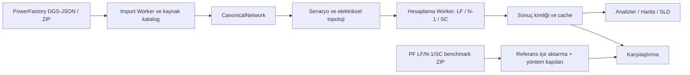

# Grid Analyzer — Şebeke Analiz Sistemi

> **Güncel kod tabanı:** `fix/psse-v1-real-model-parity` · **Uygulama sürümü:** `8.2.5` · **Doküman revizyonu:** 27.10.2026
> **Güncel kaynak geçmişi:** [V2 gerçek model parity dalı](https://github.com/murathany90/Grid_Analyzer_v7/commits/fix/psse-v1-real-model-parity/)
> **Güncel CI:** [V2 dalının validate koşuları](https://github.com/murathany90/Grid_Analyzer_v7/actions/workflows/ci.yml?query=branch%3Afix%2Fpsse-v1-real-model-parity) — durum ve test sayısı seçilen commitin koşu kaydından kontrol edilir.

Grid Analyzer, **DIgSILENT PowerFactory DGS JSON/ZIP** şebeke verilerini tarayıcıda açıp analiz etmek için geliştirilmiş, Türkçe kullanıcı arayüzüne sahip bir güç sistemi inceleme uygulamasıdır. Envanter, kaynak model kalite denetimi, işletme verileri, harita, trafo merkezi tek hat şeması, senaryo/manevra, yük akışı (LF), N-1/kısıt, kısa devre (SC) ve PowerFactory karşılaştırma iş akışlarını bir araya getirir.

Bu dal, ortak dosya seçicisine **PSS/E SAV/RAW/RAWX/ZIP** ve ayrı bus-branch çalışma modunu ekler. DGS mevcut node-breaker modeli ve motorlarıyla çalışır; PSS/E kendi modeli, worker'ı, senaryosu, NR/FDNS_XB/DC motorları ve Model/Analiz/Harita/SLD bileşenlerini kullanır. Başlıkta yeşil **DGS MODU** veya mavi **PSS/E MODU** görünür.

PSS/E için doğrulanmış sabit kontrol profilleri hazırdır. Sayısal yakınsama ile kapsam ayrıdır: sınırlı hesaplar **LIMITED_PROFILE**, eksik etkin fizik **BLOCKED** olarak yayımlanır. Büyük gerçek modelin AC uzak/droop kontrolleri ve otomatik kontrol/distributed-slack kapsamı tamamlanmamıştır; büyük DC'nin katı referans karşılaştırması **DIFFERENCES** olarak kalır. Ayrıntılar [model sadakati](MODEL_FIDELITY_REPORT.md) ve [sayısal parite](PSSE_AC_DC_PARITY_REPORT.md) raporlarındadır.

Çevrimdışı V2 dağıtımı `GA_PSSE_AC_DC_OFFLINE_TEST_FIXED.zip` içindeki `index.html` dosyasıyla doğrudan açılır; Python, PSS/E, sunucu veya internet gerekmez. [Kullanım ve paketleme](docs/PSSE_NATIVE_README_TR.md), [V2 kök neden raporu](BUG_ROOT_CAUSE.md), [DGS/PSS/E ekran karşılaştırması](UI_DGS_PSSE_PARITY.md), [mimari kararlar](ARCHITECTURE_DECISIONS.md), [solver araştırması](PSSE_SOLVER_RESEARCH.md), [DGS regresyonu](DGS_REGRESSION_REPORT.md), [performans](PERFORMANCE_REPORT.md), [YTBS AREA/ZONE/OWNER denetimi](YTBS_AREA_ZONE_OWNER_MAPPING.md) ve [agent handoff](AGENT_HANDOFF.md) bu dalın teslim belgeleridir. Gerçek lisanslı modeller ve ham referans dökümleri Git'e/ZIP'e eklenmez.

**Uygulama SCADA/EMS değildir:** Gerçek zamanlı TEİAŞ kumanda veya telemetri bağlantısı yoktur. Çizilen durumlar model/senaryo projeksiyonlarıdır; hesaplanan MW/MVAr/kV/kA değerleri fiziksel ölçüm veya onaylı işletme sınırı değildir. **LF sayısal yakınsaması, N-1 AC kontrol doğrulaması ve IEC 60909/PF paritesi birbirinden farklı kanıt düzeyleridir.**

## İçindekiler

- [Hızlı başlangıç](#hızlı-başlangıç)
- [Veri formatları ve iki yerel doğrulama modeli](#veri-formatları-ve-iki-yerel-doğrulama-modeli)
- [Uygulama ekranları](#uygulama-ekranları)
- [Analiz motorları ve mühendislik sınırları](#analiz-motorları-ve-mühendislik-sınırları)
- [PowerFactory karşılaştırma ve veri kimliği](#powerfactory-karşılaştırma-ve-veri-kimliği)
- [Mimari ve kaynak kod haritası](#mimari-ve-kaynak-kod-haritası)
- [Test, CI ve kabul kanıtları](#test-ci-ve-kabul-kanıtları)
- [Bilinen sınırlamalar ve geliştirme öncelikleri](#bilinen-sınırlamalar-ve-geliştirme-öncelikleri)
- [Belgeler ve depo düzeni](#belgeler-ve-depo-düzeni)
- [Veri güvenliği ve lisanslar](#veri-güvenliği-ve-lisanslar)

## Hızlı başlangıç

Geliştirme araçları: **Node.js 22** (GitHub CI ile aynı majör sürüm), `npm`, TypeScript, Vite ve tarayıcı. `npm ci` bağımlılıkları `package-lock.json` üzerinden kurar.

```bash
npm ci
npm run dev
```

Terminalde Vite'ın bildirdiği yerel adresi (varsayılan `http://127.0.0.1:5173/`) tarayıcıda açın. Normal ve tek HTML çıktısı:

```bash
npm run build             # dist/
npm run build:portable    # dist-portable/GridAnalyzer_v7.html
```

`dist-portable/GridAnalyzer_v7.html`, kaynak içe aktarma ve uygulama varlıkları tek dosyada paketlenmiş, yerel model ve hesap işlevleri için **çevrimdışı kullanılabilen** dağıtımdır (harici harita katmanları ağ isteyebilir). Gerçek modeller bu HTML'ye gömülmez. Dağıtımın commit edilmiş baytları GitHub CI'da üretilen HTML ile SHA-256 düzeyinde karşılaştırılır; dosyayı elle düzenlemeyin. İçe aktarma ve hesaplama büyük modellerde yüksek RAM kullanabilir; düşük bellekli ortamlar için performans garantisi verilmez.

### İlk model ve referans yükleme

1. **Model Yükle** → `JSON veya ZIP` üzerinden kaynak DGS modelinin **iç model ZIP'ini** seçin (`20261007_1400_SN3_TR0.zip` veya `20261008_1000_SN4_TR0.zip`).
2. **Karşılaştırma** → `Birleşik veya LF / N-1 / SC referans ZIP` üzerinden **aynı modelin** `Birleşik_LF_N-1_SC_referans_ZIP.zip` dosyasını ekleyin. Model ZIP ile referans ZIP'ini karıştırmayın; bir modelin referansını diğer modele bağlamayın.
3. **Analizler** → LF/N-1/SC sekmesini, YTM/TM/gerilim/profili seçin. Sonuçların kaynağını ve geçerlilik etiketlerini kontrol edin; gerektiğinde yeni hesap başlatın.
4. `ControlContext_Raw`, LF PowerFactory kitabının içindedir. **`ControlContext uygula` ayrı ve etkili bir işlemdir**: mevcut hesap kimlikleri geçersiz olur, sonuçları yeniden hesaplamak gerekir.
5. CSV/XLSX/JSON dışa aktarımlarında `GA`, `PF`, `Δ=GA−PF`, birim, sonuç kimliği, eksik veri ve yöntem kanıtını birlikte değerlendirin.

## Veri formatları ve iki yerel doğrulama modeli

Uygulama **PowerFactory `.dgs` metin dosyasını doğrudan okuyor** anlamına gelmez: doğrulanan giriş, sınıf tabloları (`ElmTerm`, `ElmLne`, `ElmTr2`, `StaCubic` vb.) içeren **DGS yapılı JSON** veya bu JSON'un bulunduğu ZIP arşividir. Kaynak giriş ile CanonicalNetwork (hesap modeli) aynı veri temsili değildir.

Yerel, Git'e gönderilmeyen `kontrol1/` klasöründe iki çalışma bulunmaktadır:

| Çalışma | DGS-JSON model ZIP | PowerFactory referansı | Çalışma zamanı |
|---|---|---|---|
| **SN3** | `20261007_1400_SN3_TR0.zip` | LF + N-1 + SC; 3 XLSX / 3 manifest / 3 log | 07.10.2026 14:00 |
| **SN4** | `20261008_1000_SN4_TR0.zip` | LF + N-1 + SC; 3 XLSX / 3 manifest / 3 log | 08.10.2026 10:00 |

Dizin yapısı:

```text
kontrol1/                                 # Yerel ve Git tarafından yok sayılır
├── 20261007_1400_SN3_TR0_dosyaları/
│   ├── 20261007_1400_SN3_TR0.zip
│   └── Birleşik_LF_N-1_SC_referans_ZIP.zip
├── 20261008_1000_SN4_TR0_dosyaları/
│   ├── 20261008_1000_SN4_TR0.zip
│   └── Birleşik_LF_N-1_SC_referans_ZIP.zip
└── KONTROL1_TEST_VERI_ENVANTERI.md       # Ayrıntılı YEREL envanter / kullanım dosyası
```

**Bu README'de yalnızca genel envanter vardır.** Modelin/PowerFactory paketlerinin SHA-256'ları, çalışma kitabı sekmeleri, PF kimliği, N-1 vaka ve SC kapsama sayıları, sınıf envanteri ve kabul kontrol listesi **yerel `kontrol1/KONTROL1_TEST_VERI_ENVANTERI.md`** içindedir. `kontrol1` GitHub'a yüklenmemeli; ağdan herkesin indirebileceği örnek fixture gibi değerlendirilmemelidir. `tests/fixtures/small-dgs.json` ayrı, küçük ve sentetik bir herkese açık test girdisidir.

**Eski README uyarısı:** Daha önce kök README'de anılan 2026-10-01 SN4 / 2026-10-04 SN7 yolları bu iki yeni yerel referans paketiyle **aynı veri seti değildir**. Eski yol ve sayısal karşılaştırmalar tarihsel belgelerde bulunabilir; yeni çalışmanın kanıtı olarak otomatik kullanılmaz.

## Uygulama ekranları

Kaynak: `src/app/app-shell.ts`, ilgili `src/features/*` ve `src/map/*` kodu.

| Sekme | İşlev / kullanım | Temel uyarı |
|---|---|---|
| **Model Yükle** | DGS JSON/ZIP içe aktarma, kaynak sınıf/uyarı ve kalite özeti | Kaynakta olmayan topoloji uydurulmaz |
| **Şebeke Envanteri** | TM, hat, trafo, bara, üretim vb. kaynak varlıklarının filtreli tabloları | Fiziksel terminal ile elektriksel bara aynı değildir |
| **İşletme Verileri** | Yük, üretim, teçhizat/işletme girdileri ve ilgili görünüm | Kaynak veri ile senaryo müdahalesi ayrıdır |
| **Harita** | CBS konumları, gerilim katmanları, sonuç ve yön okları, Lightning | Nominal kV rengi enerjilenme ya da akış doğruluğu kanıtı değildir |
| **Tek Hat Şeması** | **Seçili tek TM** için SVG şalt/fider/baralar, anahtarlar, trafo ve analiz bindirmeleri | **Bölgesel tüm YTM şeması henüz ayrı bir mod değildir** |
| **Analizler** | Tam genişlikli LF, N-1 ve SC sonuçları; filtre/sıralama/sayfalama, detay diyaloğu | Durum/KPI ve yöntem kanıtı sonuca ait olmalıdır |
| **Karşılaştırma** | Üç referans ailesi, ham/karşılaştırma sekmeleri ve isteğe bağlı tanısal fark | PF referansı GA motor girdisi değildir |
| **Yardım / Ayarlar** | Bağlamsal açıklamalar, senaryo, analiz ve gösterim seçenekleri | Ayar değişince önceki sonuç `stale` olabilir |

### LF (Yük Akışı) listeleri

- **Hatlar:** kaynak `FROM` ucundaki imzalı P (MW), Q (MVAr), yüklenme (%); GA/PF/Δ.
- **Trafolar:** kaynak doğrulandığı durumda **HV tarafı** P ve Q; yüklenme kaynak kapasite bazında en yüksek uç değeridir (salt HV yüzdesi değildir); HV'nin kaynaktaki `TO` terminali olabileceği hesaba katılır.
- **Baralar:** ≥66 kV görünümünde GA U (kV), PF U (kV), ΔU; aynı elektriksel barayı temsil eden terminaller karşılaştırmada eşlenir.
- Çözüm **yakınsamadıysa** sonuç başarı diye gösterilmez. Bulunmayan PF değeri veya karşılaştırılamayan delta **sıfır değildir**.

### N-1/kısıt listeleri

Varsayılan liste bütün adayları içerir; aday sayısı, DC taranan, AC denenen, AC sayısal çözülen, AC tam kontrol doğrulanan ve farklı DC∪AC kapsama sayaçları **ayrı** tutulur. Kesinti/aşırı yüklenen ekipmanlar listelerinde AC gerçek hesap, DC yaklaşık tarama ve PowerFactory'de **seyrek kaydedilmiş** vakalar farklı kanıt sınıflarıdır. Vaka detayı seçildiğinde POST ve gerekirse önbellekten yükleme görünür; olmayan POST değeri `0` değildir.

### SC/kısa devre listeleri

Görünümde varsayılan `>66 kV` elektriksel bara kapsaması; gerektiğinde fiziksel terminal alias listesi, MAX/MIN modları, GA yaklaşık Ikss (kA), PF referans Ikss ve yalnızca geçerli kimlik/yöntem kapısıyla tanısal fark bulunur. `Skss`, `Zkk`, `ip`, `Ib`, `Ith` gibi alanlar veri/motor desteği yoksa **boş/bilinmiyor** kalır; uydurulmaz.

## Analiz motorları ve mühendislik sınırları

| Analiz | Gerçek uygulama kapsamı | **Ne değildir?** |
|---|---|---|
| **Full AC LF** | Newton–Raphson, pozitif sıralı ağ; KLU tabanlı seyrek çözüm; kaynak tip/tap/Q/istasyon kontrol hazırlığı, model/senaryo kimliği | Tüm generatör aktif-set ve reaktif sınırlarının PF'yle birebir doğrulandığı sertifika |
| **Fast AC / DC** | Hızlı/indirgenmiş analiz ve DC aktif güç yaklaşımı | Tam AC voltaj, reaktif güç veya termik güvenlik kanıtı |
| **N-1** | Aday kataloğu → DC eleme → seçilmiş vakalarda AC hesap → sınırlı kontrol kanıtı; duraklat/devam/bütçe | 660/664 adayın tamamına Full AC çözümü veya PF tam POST matrisi |
| **SC 3 faz** | Pozitif bileşen ağ üzerinden yaklaşık Ikss/Skss ve kaynak eksiklik raporu; MAX/MIN mühendislik ayarları | Bağımsız, normatif **IEC 60909-0:2016 doğrulanmış** çözüm veya güvenilir ekipman açma/kesme dayanımı hesap paketi |

N-1 sayısal AC sonucu **`AC_VERIFIED` sayılmaz**; `COMPLETE` çalışma akışının bitmesini, her kesintinin başarılı/kanıtlı olduğunu değil belirtir. YTM kapsamı dışındaki elemanlar N-1 etkilerini etkileyebilir; tarama ve etkiler için ağın elektriksel bütünlüğü korunmalıdır. SC için `FAST_3PH`, `ENGINEERING_EXTENDED`, `IEC_REFERENCE_VERIFIED` profil adları bulunması sonuncusunun sayısal doğrulamadan geçtiği anlamına gelmez. Kodda görünen mühendislik varsayımları normatif kısa devre düzeltme katsayısı olarak kullanılmaz.

Güç akışı temel denklemi `I = Ybus × V`, `S = V × conj(I)`; dengeli AC Newton çözümünde aktif/reaktif artıklar azaltılır. PowerFactory karşılaştırması farklı referans/çözüm durumları arasında sayısal kalibrasyon için değil, **bağımsız uygunluk tanısı** içindir.

## PowerFactory karşılaştırma ve veri kimliği

Referans içe aktarma `src/importers/powerfactory-benchmark`, doğrulama kapıları `src/domain/benchmark` ve arayüz `src/features/comparison` içindedir. Üç birleşik referans `LF`, `N1`, `SC` aileleri olarak yüklenir; her aile **kendi workbook/manifest/exporter sürümünü** taşır. Sürümlerin farklı olması otomatik hata değildir.

1. **Model / study case / scenario:** DGS kaynak kimliği ile referans meta kimliği ve gerekli eşleme profili uyuşmalıdır.
2. **Topoloji:** Kaynak sınıfı + FID + elektriksel terminal/bara üyeliği ve dal uçları açıkça karşılaştırılmalıdır. Salt benzer isimle fiziksel eşdeğerlik kabul edilmez.
3. **Çalışma yöntemi:** PF paketinin `effectiveMethod` alanı, aynı yöntem ailesinin beyanıdır; **PF ile Grid Analyzer'ın sayısal algoritma paritesi kanıtı değildir**. LF karşılaştırma `diagnostic` modda yöntem/ayar farkını açıkça gösterebilir.
4. **Ölçü ve yön:** Hat `FROM`, trafo `HV`, bara `kV`; Δ işaretli `GA−PF`. Ayrı kaynak durumları veya terminal yönleri karşılaştırılmadan yüzdesel hata hesaplanmaz.
5. **Kapsama:** N-1 **recorded extrema** tam vaka matrisi değildir. SC elektriksel ve fiziksel baralar farklıdır. `NOT_RECORDED`, `UNKNOWN`, `NOT_COMPUTABLE`, `RECORDED_ZERO` aynı statü değildir.
6. **Kanıt:** SHA-256, model/senaryo/options/source hash, durum, kalite ve koşu süresi alanları sonuca bağlanmalıdır. Sonuç kimliği bozulursa eski sonuç yeni görünümde kullanılmamalıdır.

Referansın LF çalışma kitabında `GA_Reference_Raw` ve `ControlContext_Raw`; N-1'de `N1_Cases_Raw`, `N1_RecordedExtrema_Raw`, `N1_CaseCoverage_Raw`; SC'de `SC_BusResults_Raw`, `SC_CalculationBus_Raw`, `SC_DeviceResults_Raw` bulunur. Yerel envanter kitabı bu sekmeleri ve kaynak durumlarını ayrıntılandırır.

## Mimari ve kaynak kod haritası

**Kanonik akış:**



| Yol | Sorumluluk |
|---|---|
| `src/app` | Uygulama denetleyicisi, sekme kabuğu, kontratlar ve worker yaşam döngüsü |
| `src/importers/dgs`, `src/importers/model-file.ts` | DGS sınıf tabloları, ZIP seçimi, katalog ve kanonik içe aktarma |
| `src/importers/powerfactory-benchmark` | OOXML XLSX/ZIP/manifest içe aktarma ve kaynak doğrulaması |
| `src/domain/model`, `src/domain/scenario`, `src/topology` | Ekipmanlar, kapasite, durum/undo, terminal/topoloji |
| `src/domain/results`, `src/domain/benchmark` | Çözüm kimliği, durum, cache ve PF eşleme/kanıt kapıları |
| `src/analysis/power-flow`, `fast-ac`, `dc` | Full NR, hızlı AC ve DC sayısal motorları |
| `src/analysis/contingency-hybrid`, `contingency-ac`, `ytm-study` | N-1 tarama/AC vakaları, toplu YTM çalışma akışı |
| `src/analysis/short-circuit` | 3 faz yaklaşık SC, kaynak adapteri ve mühendislik profilleri |
| `src/features/analysis`, `src/features/comparison` | Kompakt tablolar, KPI/diyalog/filtre/export ve referans UI |
| `src/features/sld` | Seçili TM'ye ait kaynak kanıtlı SVG tek hat geometrisi |
| `src/map` | CBS katmanları, Canvas, yön/sonuç ve Lightning |
| `src/workers`, `src/persistence`, `src/styles` | Worker protokolü, saklama, uygulama stilleri |
| `tests/unit`, `tests/regression`, `tests/fixtures` | Birim/regresyon ve sentetik test verileri |
| `tools` | Tarayıcı kabul, test/bütünlük ve gerçek-model yerel denetim araçları |

`src/features/sld/sld-view.ts` kapsamı mevcut sürümde **tek istasyondur** (`station`). Orta Anadolu YTM'nin tüm 400/154 kV TM bağlantılarını gösteren SCADA-benzeri **bölgesel şema** henüz geliştirilmiş değildir; TEİAŞ gerçek SCADA ekranıyla eşdeğer veya kumanda arayüzü olarak sunulmamalıdır.

## Test, CI ve kabul kanıtları

Önerilen doğrulama sırası:

```bash
npm ci
npm run typecheck
npm run lint
npm test
npm run test:e2e
npm run build
npm run build:portable
```

- `npm test`: `tests/unit/*.test.ts` + `tests/regression/*.test.ts`.
- `npm run test:e2e`: Playwright/Chromium ile sıralı tarayıcı zinciri; SLD, harita, karşılaştırma, model yükleme, N-1/SC, kompakt LF/N-1/SC UI ve dışa aktarma denetimleri.
- `npm run build:portable`: offline HTML'yi yeniden üretir. CI **kaydedilmiş portable dosya ile yeniden derlenen baytların SHA-256 eşitliğini** zorunlu tutar.
- GitHub CI `validate` işi tip/lint, unit/regression, tarayıcı, derleme ve portable bayt kontrollerini çalıştırır. [main CI koşularında](https://github.com/murathany90/Grid_Analyzer_v7/actions/workflows/ci.yml?query=branch%3Amain) ilgili commitin sonucu ve test sayısı incelenmelidir; bir koşunun başarısı diğer commitler için doğrulama sayılmaz. Bu **kamuya açık sentetik CI** özel gerçek modelleri kullanmaz.
- Kullanıcının yerel kabulü: Orta Anadolu gerçek LF görünümünde **306 hat, 354 trafo, 218 bara** ve yatay taşmasız dokuz görünüm bildirilmiştir; gerçek ekran/hash dosyaları **yerel** `local-benchmark-results/analysis-ux/real-lf-final/` altındadır. Bu kabul, PF/IEC parite sertifikası değildir.

### İsteğe bağlı gerçek-model runner

`npm run test:full` yalnız `kontrol1/<çalışma>_dosyaları/<çalışma>.zip` model arşivlerini keşfeder; PF referans ZIP'i hesap girdisi değildir. Adlar ve model sayısı sabitlenmez. Arşiv boyutu/yol/CRC ve DGS şeması mevcut güvenli importer ile denetlenir. Sonuçlar yalnız Git dışı `local-benchmark-results/full-model-results.json` içine yazılır; eski `docs/validation/full-model-results.json` tarihsel kanıttır.

```bash
npm run test:full -- --list  # Yalnız keşif: NOT_RUN; model hesabı yapılmaz
# İsteğe bağlı env: MODEL_ROOT, MODEL_FILTER; REQUIRE_MODELS=1 eksik modelde exit 2 üretir.
```

Gerçek hesap çalıştırılırsa baz NR, senaryo AC, Fast AC ve DC yakınsaması birlikte denetlenir. `PASS` yalnız çalıştırılmış ve yakınsamış sayısal regresyonu belirtir; PF/IEC doğrulaması değildir. Kaynak veya filtre eşleşmesi yoksa `SKIP`, hesap hatası/yakınsamama varsa `FAIL` (exit 1) yazılır. Keşif/skip hiçbir zaman gerçek model PASS'i olarak sayılmaz. Bu dokümantasyon turunda büyük model benchmark'ı çalıştırılmadı.

## Bilinen sınırlamalar ve geliştirme öncelikleri

1. **PF sayısal paritesi:** SN3/SN4/N-1/SC gerçek model karşılaştırmalarında yöntem, terminal/kontrol ve ölçü eşlemesi nedeniyle açık tanısal farklar bulunur; `PF parity verified` etiketi verilmez.
2. **N-1 AC kapsama:** Süre bütçesi/ada/çözüm/kontrol kanıtı bazı vakaları yalnız DC tarama veya denenmedi statüsünde bırakır. `AC_VERIFIED=0`, **AC çözümü yok** anlamına gelmez; tam kontrol kanıtı yoktur.
3. **SC/IEC:** Hesap **pozitif bileşen mühendislik yaklaşımıdır**. IEC 60909-0:2016 kaynak/topraklama, katkı, düzeltme, ip/Ib/Ith ve PF eşdeğerliği tamamlanmamıştır. Manifestteki `IEC 60909` etiketi PF kaynağının beyanıdır, Grid Analyzer'ın bağımsız doğrulaması değildir.
4. **SLD:** Seçilen TM için ayrıntılı SVG desteklenir; Orta Anadolu 400/154 kV bölgesel SCADA ağı şu anda mevcut değildir.
5. **Test verisi yolu:** Aktif gerçek-model runner `kontrol1` ZIP yapısını kullanır; eski baseline araçları yalnız açık `LEGACY_MODEL_JSON` girdisiyle çalıştırılır. `kontrol1/` gizli kalır; yanlışlıkla özel kaynakları Git'e eklemek yasaktır.
6. **Belgelerin yaşı:** Eski sürüm/araştırma/kabul raporları tarihsel kayıttır. Özellikle mimari belgelerdeki eskimiş “yoktur” ifadeleri güncel kaynak koduna üstün tutulamaz.
7. **Model ölçeği:** DGS JSON'un bellekte maddileşmesi ve bütün PF workbook'larının ayrıştırılması bellek/CPU tüketir; bütün sonuçların tek ekranda ya da tüm N-1 vakalarının doğrulanmış olması beklenmez.

## Belgeler ve depo düzeni

**Bu dosya tek kök `README.md` olarak kalmalıdır.** Teknik notlar/raporlar `docs/` altındadır. Temel kaynaklar:

| Amaç | Belge |
|---|---|
| Mimari başlangıç | [`docs/architecture.md`](docs/architecture.md) |
| DGS sınıf/veri profili | [`docs/dgs-source-profile.md`](docs/dgs-source-profile.md) |
| Eski HTML bağımlılık haritası (tarihsel) | [`docs/module-dependency-map.md`](docs/module-dependency-map.md) |
| PF benchmark sınırları | [`docs/benchmark/IMPLEMENTATION_REPORT.md`](docs/benchmark/IMPLEMENTATION_REPORT.md) |
| Gerçek SN3 kabulü (tarihsel) | [`docs/benchmark/SN3_OA_INDEPENDENT_ACCEPTANCE.md`](docs/benchmark/SN3_OA_INDEPENDENT_ACCEPTANCE.md) |
| N-1/SC mühendislik tasarımı | [`docs/n1-sc-engineering-development-20261022.md`](docs/n1-sc-engineering-development-20261022.md) |
| N-1/SC birleştirme kabulü | [`docs/n1-sc-workspace-unification-acceptance.md`](docs/n1-sc-workspace-unification-acceptance.md) |
| Analizler yeni UI | [`docs/analysis-workspace-ui-design.md`](docs/analysis-workspace-ui-design.md) · [`kabul`](docs/analysis-workspace-ui-acceptance-20261022.md) |
| SLD çizim kuralları | [`docs/SLD_DRAWING_RULES.md`](docs/SLD_DRAWING_RULES.md) |
| Kısa devre metodolojisi | [`docs/short-circuit-architecture.md`](docs/short-circuit-architecture.md) |
| Yerel iki-model envanteri | `kontrol1/KONTROL1_TEST_VERI_ENVANTERI.md` (**GitHub dışında**) |

Güncel rehberler [belge dizininde](docs/README.md), geçmiş kabul kayıtları [tarihçe dizininde](docs/history/README.md) bulunur. Eski iki kök raporu `docs/history/` altına taşınmıştır. Alt projelerin `future/` README'leri ve kaynak lisans açıklaması kendi bağlamlarında korunur. Boş izlenen test/araç yoktur; isteğe bağlı yerel araçlar ve aktif SLD/regresyon kanıtları korunmuştur.

### Geliştirme/PR politikası

`main` korunur; her değişiklik ayrı feature branch + PR + başarılı `validate` CI ile kabul edilir. Yürürlükteki sonuç sözleşmeleri ve byte-deterministik portable çıktı bozulmamalıdır. Gerçek veri testleri ayrı ve Git dışı tutulur. Veri temizliğinde önce *silme adayları ve kullanım yerleri* listelenir; kullanılmayan dosya ancak gerçek kod/CI referans taraması ve regresyon sonrası kaldırılır.

## Veri güvenliği ve lisanslar

- Gerçek DGS modelleri, PowerFactory XLSX/manifest/log, özel FID/CSV, kabul ekranları, cache dosyaları ve tokenlar **repo/PR/CI'ya yüklenmez**. `.gitignore`, `kontrol1/`, `control1/`, `.local-fixtures/` ve `local-benchmark-results/` yolunu yok sayar; **önceden izlenen dosyaları yalnız `.gitignore` gizlemez**.
- Modelin ZIP ve referans ZIP içindeki hash/kimlikleri kullanıcıya ait yerel raporda tutulur. Güncel GitHub `main` bu ZIP'leri içermez.
- Lisans metinleri `licenses/` klasöründe; `klu-js`, `saxes`, `xmlchars`, `@noble/hashes` paketlerinin bildirimleri portable HTML içine dahil edilir. Değişikliklerde bildirimleri koruyun.
- Bu yazılımın analizleri mühendislik karar desteğidir; tek başına koruma koordinasyonu, devre kesici seçimi, resmi kabul veya SCADA manevra talimatı olarak kullanılamaz.

---

*Bu README, 23.10.2026 tarihinde GitHub kaynak kodu/CI incelemesi ve kullanıcının eklediği iki gerçek model + PF referans ZIP envanteri üzerine hazırlanmıştır. Yeni bir gerçek benchmark veya tüm vakalar için PF/IEC parite koşusu yapıldığı iddia edilmez.*

V3 çalışan yaklaşık AC aşaması: [kök neden ve çözüm](AC_ROOT_CAUSE_AND_SOLUTION.md), [AC/FDNS/DC paritesi](PSSE_AC_FDNS_DC_PARITY.md), [koordinat denetimi](GEO_COORDINATE_FIT_AUDIT.md), [TM tek hat kabul durumu](SLD_TM_PARITY.md) ve [DGS regresyon kapsamı](DGS_REGRESSION.md). İleri kontroller ve görsel kabul eksikleri bu raporlarda açıkça listelenir.
