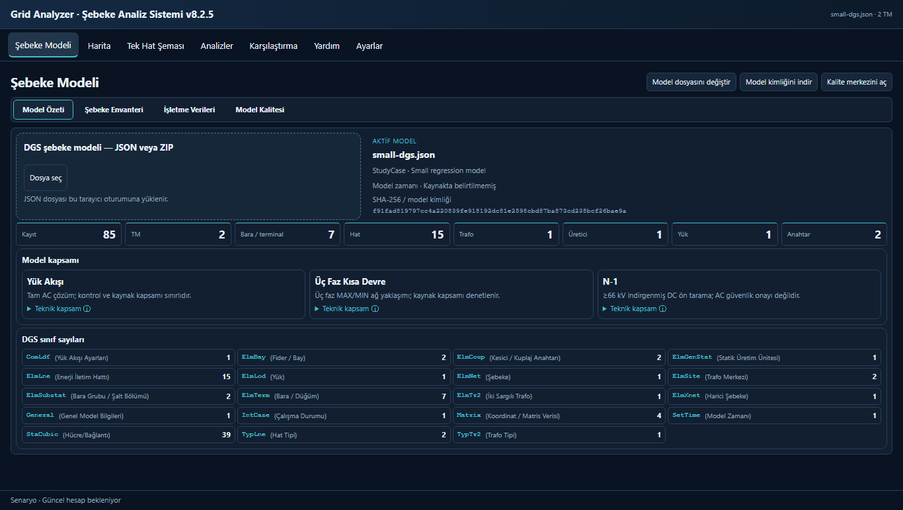
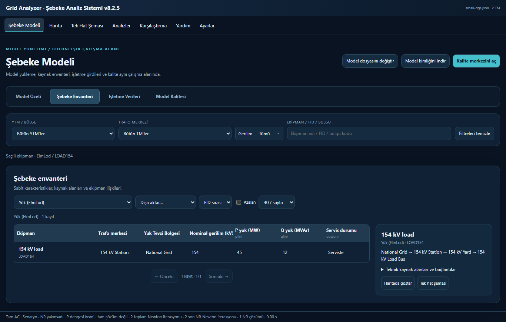
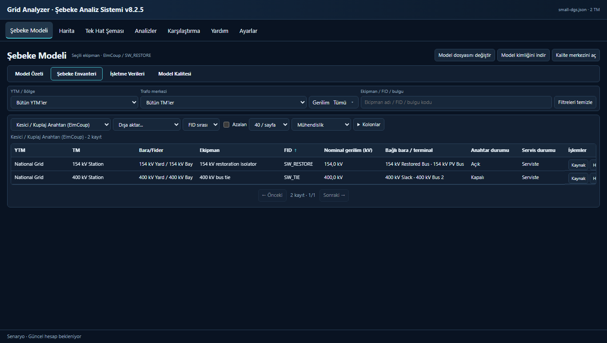
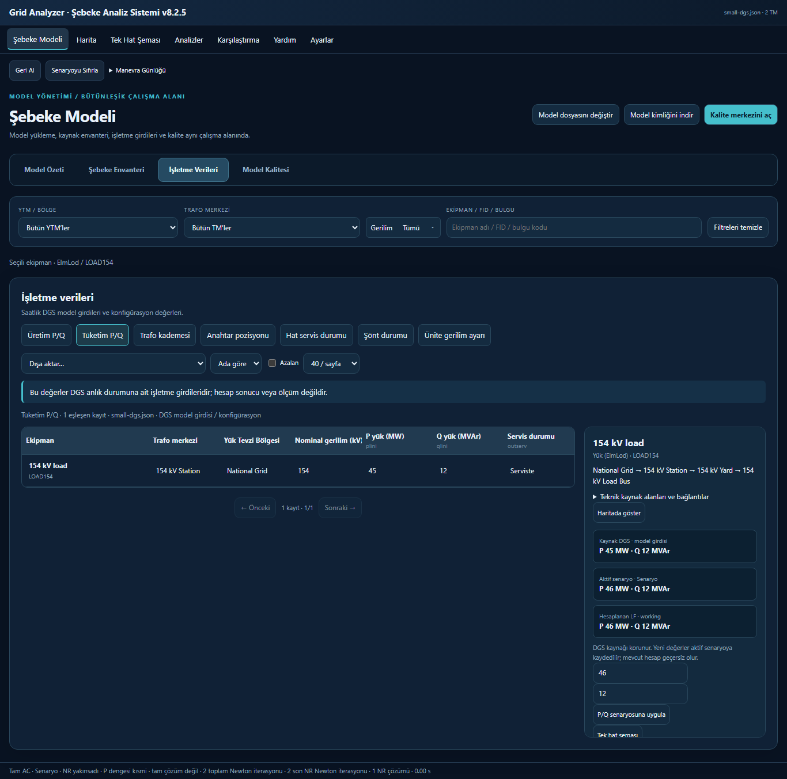
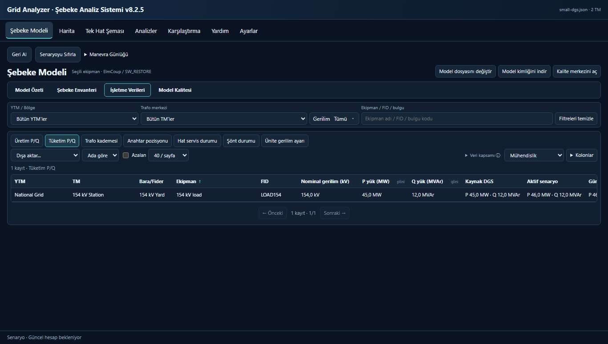
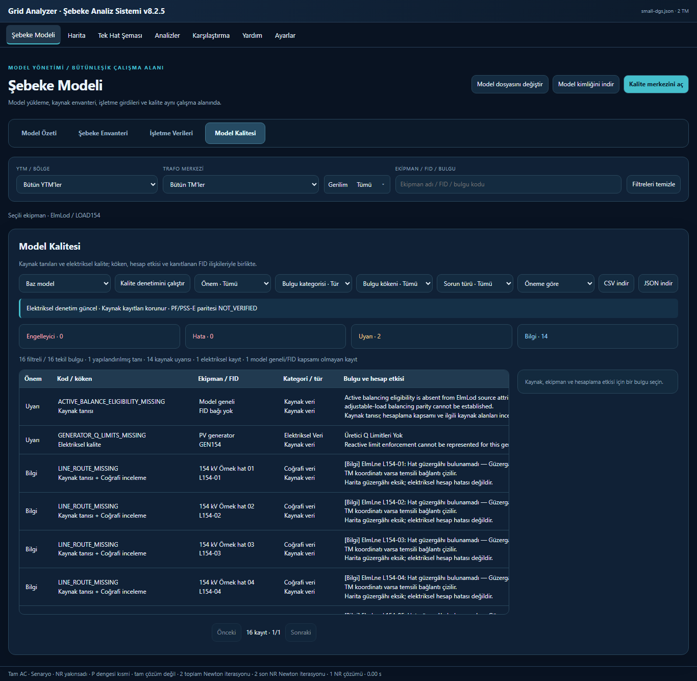
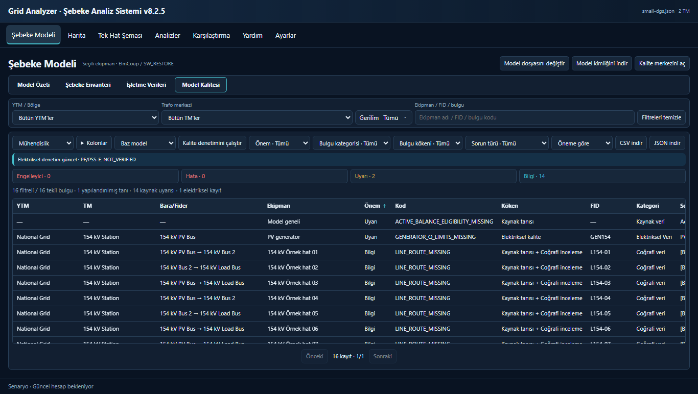

# Şebeke Modeli çalışma alanı — PR #15

Geliştirme aynı `feature/unified-network-model-workspace` dalındadır. İncelenen önceki HEAD `837076302b1f0ab2ee2fc9c1b9eecb6b7faa72ad`; hedef main tabanı `fa3d3e8b676a1440605a5c9e8a5babe400184169`. PR #15 üzerinde geliştirilir. 25 Ekim son görevinde kullanıcı, bütün kabul ve CI kapıları başarılıysa PR merge ve Pages yayınına açık yetki vermiştir. Yayın ancak exact-head CI, main CI, Pages deployment ve canlı sürüm doğrulamasıyla tamamlanmış sayılır.

## Kompakt masaüstü arayüzü

Dört alt sekme korunur: Model Özeti, Şebeke Envanteri, İşletme Verileri ve Model Kalitesi. Özetin sağlık kartı kaldırılmıştır; kalite bulguları kalite sekmesindedir. İstatistikler tek sıradadır. Sınıf kartları ortak DgsSemanticDictionary açıklamalarını gösterir ve aynı envanter sınıfını açar. Kabiliyet statüleri değiştirilmez; büyük PARTIAL metni yerine Türkçe kısa kapsam ve açılır teknik açıklama vardır. Yöntem sınırları ve NOT_VERIFIED parite bilgisi erişilebilirdir.

Envanter, işletme ve kalite tabloları tam genişliktedir. Kalıcı sağ panel yoktur. Sabit başlıklar, 30 px tek satır, iç yatay/dikey kaydırma, tam metin tooltip ve kaynak/kanıt pencereleri kullanılır. Sıra her profilde `YTM → TM → Bara/Fider → Ekipman → Teknik parametreler → Durum → İşlemler` biçimindedir. Hatlarda iki uç TM/YTM bilgisi gösterilir; kaynak ilişkisi olmayan alanlar — kalır.

Mühendislik/Kompakt ve tüm kaynak alanları/kanıt profilleri ile kolon seçimi desteklenir. Teknik CSV/JSON dışa aktarımı kolon seçimine bakmadan bütün DGS alanlarını ve kaynak referanslarını korur. İşletmede kaynak, aktif senaryo ve güncel LF ayrı sütunlardır; düzenleme ve manevralar satırdan açılan pencerelerde mevcut ScenarioStore/controller komutlarını kullanır. Model/senaryo değişiminde eski işlem reddedilir. LF değeri yoksa girdiler sonuç gibi gösterilmez. Değişiklikler hesap motorlarına veya elektriksel topolojiye müdahale etmez.

Ortak YTM/TM/gerilim/arama, seçim, görünür sekme sorguları ve IndexedDB kimlik denetimleri korunur. Kapsam değişince eski sorgu yanıtları reddedilir. Tek sınıflı işletme sayfaları doğrudan offset sorgusu kullanır; çok sınıflı sıralı birleştirmede önceki kaynak sayfaları sınırlı ve modele bağlı önbellekten okunur. Toplam/sıralama/sayfa doğruluğu regresyonlarla denetlenir.

## Sınıf açıklamalarının kaynağı

Yereldeki DIgSILENT PowerFactory 2024 User Manual (`Downloads/dgs/dgs/Help/UserManual_en.pdf`): PDF s.227 nötr topraklama elemanı ElmNec, s.277 sanal santral/üretim grubu ElmBmu, s.289 modelde sahiplik gruplaması ElmOwner. Sonuncusu raporlama/model gruplamasıdır; hukuki mülkiyet doğrulaması veya çıkarımı değildir. Tam metin kılavuz veya özel model dosyaları depoya eklenmez.

## ElmSite koordinat denetimi

Kaynak GPS alanları değişmez. Önce bütün ElmSubstat → ElmSite → YTM ilişkileri okunur. TM'nin herhangi bir bağlı grubunda mevcut geçerlilik sınırları içinde bir GPS çifti varsa ilk geçerli kaynak çifti korunur; sıfır/boş/geçersiz kardeş gruplar tekrar uyarı üretmez.

Geçerli çifti olmayan her TM için tek `SITE_COORDINATES_MISSING` kaydı üretilir. `NO_ATTACHED_SUBSTATION` ile `NO_VALID_GROUP_COORDINATES` nedenleri ayrıdır. Birden fazla geçerli çift çelişirse `SITE_COORDINATES_CONFLICT` üretilir. Eski 0,12° eşiği `sqrt(Δenlem² + Δboylam²)` olarak açıkça belirtilir; ek uzaklık Haversine yöntemiyle, 6371,0088 km küre yarıçapıyla km cinsinden verilir. Bu açı eşiği kilometre eşiği diye sunulmaz. Koordinat ortalaması, sahte konum veya elektriksel bağlantı üretilmez.

Yeni coğrafi kaynak tanıları ElmSite FID'sine bağlıdır; kaynak grup FID'leri/alanları kanıtta korunur. Böylece YTM/TM kalite filtreleri aynı kayıtları tutar. Bağlı grup/gerilim bilgisi olmayan TM'ler bütün gerilimler kapsamındaki TM seçicisinde görünür.

### Gerçek SN7 eski/yeni doğrulaması

Aynı yerel ZIP: **587.301 kayıt, 1.625 ElmSite, 4.925 ElmSubstat**.

| Denetim | Önce | Sonra |
|---|---:|---:|
| Geçerli kaynak koordinatı olan TM | 1.560 | 1.560 |
| Geçerli kardeşi olan koordinatsız grup uyarısı | 3.150 | 0 |
| Koordinatı belirsiz TM'nin tekil kaydı | Dağınık/türetilmiş | 65 |
| Bağlı ElmSubstat kaydı olmayan TM | 65 | 65 (ayrı neden) |
| 0,12° üzerinde geçerli koordinat çelişkisi | 0 | 0 |

`tools/site-coordinate-real-audit.ts` eski HEAD'in DGS okuyucusunu yerel geçici alanda aynı kaynakla çalıştırıp diğer kaynak sorunlarının, elektriksel canonical dizilerin, kabiliyetlerin ve seçilen TM koordinatlarının değişmediğini bağımsız karşılaştırır. Özel kaynaklar/kanıt JSON'ları yalnız `local-benchmark-results/network-model-workspace/` altında kalır; Git veya deployment artifact'ına eklenmez.

## Kabul ve testler

- Birim regresyonları: geçerli + sıfır, tümü geçersiz, hiç grup yok, çelişen geçerli çiftler, eşik içindeki çiftler; coğrafi kaynak/FID/filtre ilişkileri; sıralı katalog önbelleği ve sayfa doğruluğu.
- Tarayıcı: dört sekme, kolon profilleri/seçimi, tüm ham alanların CSV/JSON'u, tek satır/sabit başlık, harita/SLD, kaynak-senaryo-LF ayrımı, STALE, P/Q düzenleme, hat/anahtar işlemleri ve geri alma, model kimliği/IndexedDB geri yükleme, iptal/ZIP, açık/koyu tema.
- Masaüstü: 1366×768, 1920×1080 ve %125 ölçek. Mobil/tablet kapsam dışı.
- Typecheck, lint, tam test ve dokuz E2E paketi; standart/Pages/portable build ve deterministic portable Git byte eşitliği teslimde doğrulanır. Pages build yayın değildir. Son SHA ve exact-head CI sonucu PR açıklamasında yer alır.

## Önce / sonra (kamusal sentetik model)

| Bölüm | Önce | Sonra |
|---|---|---|
| Özet |  |  |
| Envanter |  |  |
| İşletme |  |  |
| Kalite |  |  |

## Son sıralama, hassasiyet ve görünür alan düzeltmeleri

Üç tablonun başlıkları artan/azalan sıralamayı `↑/↓` ve `aria-sort` ile bildirir. Ortak Türkçe karşılaştırıcı kaynak sayısal alanlarını gerçek sayı olarak sıralar; eksikler her iki yönde sonda, eşit değerler FID ve sınıf sırasındadır. Filtrelenmiş kaynak indeksinin tamamı Worker'da sıralanır, ardından sayfalanır. Karma sınıfların birleştirmesi ve dışa aktarımı aynı karşılaştırıcıyı kullanır. Görünür hiyerarşi/context alanları da gösterilen ilişkilere göre sıralanır.

İşletmenin kaynak/senaryo/LF sıralama anahtarları mevcut canonical girdilerden ve kimliği doğrulanmış sonuçlardan oluşturulan, model/hash ve senaryo/sonuç bağlamına bağlı salt okunur snapshot'tır. Özet P sonra Q sırasını kullanır; kolon seçicide ayrı Kaynak/Senaryo/LF P-Q sütunları açılabilir. STALE veya başka kapsamın sonucu anahtar olarak da kullanılmaz. Hesap motorları ve elektriksel topoloji değişmemiştir.

Ölçüm metinleri varsayılan bir ondalıkla Türkçe, kayıt/kademe adetleri tam sayı gösterilir. 0,05 altındaki sıfır dışı değerler ek anlamlı basamakla, çok küçük değerler bilimsel gösterimle korunur. Hücre tooltip'i, tüm kaynak alanları profili ve teknik CSV/JSON özgün hassasiyeti korur; girdiler yuvarlanmaz.

Tablo yüksekliği yalnız görünür viewport koordinatlarından, gerçek CSS ölçeğinden ve ölçülmüş alt kontrollerden hesaplanır. `scrollY` ikinci kez eklenmez; scroll/resize ve zoom yeniden ölçülür. YTM/TM/ekipman/FID genişliğin en fazla %70'i içinde sabitlenir; yatay kaydırma ve sabit başlıklar korunur. Sınıf kartlarında kod, Türkçe açıklama ve adet ayrıdır. Seçim bilgisi başlık içine, uzun veri kapsamı açıklaması açılır bilgiye taşınmıştır.

Yeni regresyonlar: tüm filtreli kaynaklar üzerinde numeric sort, karma sınıf yüksek sayfa, eksik/FID tie-break, LF snapshot kimliği, senaryo/STALE, Türkçe küçük değerler ve viewport/zoom. Dokuzuncu E2E içinde 50 kaynak yük, 43 karma üretici, gerçek Full AC çözülmüş 50 yük ve 45 sentetik kalite bulgusunun tüm sayfaları bağımsız beklenen değerlerle karşılaştırılır; JSON hassasiyeti ve karma sıralaması denetlenir. Sentetik test verisi yalnız kamusal fixture üretimidir; üretim uygulamasına veya özel model artifact'ına eklenmez.
